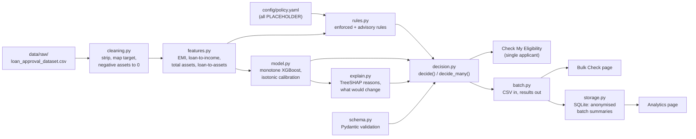

# LoanLens, explained

LoanLens is an independent proof of concept by Anshu Raj. It is not affiliated with or endorsed by any bank or lender. It is a prototype for learning and demonstration, not a lending decision, and it uses public synthetic data only.

This document has two parts. Part 1 is for anyone; it uses no jargon. Part 2 is for technical readers.

## Contents

**[Part 1: The project in plain English](#part-1-the-project-in-plain-english)**
1. [The problem](#the-problem)
2. [What LoanLens does](#what-loanlens-does)
3. [Two short stories](#two-short-stories)
4. [The data](#the-data)
5. [How a decision is made](#how-a-decision-is-made)
6. [What the colours and labels mean](#what-the-colours-and-labels-mean)
7. [What LoanLens is not](#what-loanlens-is-not)
8. [Honest limits](#honest-limits)
9. [What a real lender would need to add](#what-a-real-lender-would-need-to-add)
10. [Glossary](#glossary)

**[Part 2: Technical deep dive](#part-2-technical-deep-dive)**
1. [Architecture](#1-architecture)
2. [Data](#2-data)
3. [Feature engineering and EMI](#3-feature-engineering-and-emi)
4. [Policy rules engine](#4-policy-rules-engine)
5. [Modelling](#5-modelling)
6. [Explainability](#6-explainability)
7. [Decision engine](#7-decision-engine)
8. [Batch pipeline](#8-batch-pipeline)
9. [UI and theme](#9-ui-and-theme)
10. [Testing](#10-testing)
11. [Benchmark](#11-benchmark)
12. [Security and privacy](#12-security-and-privacy)
13. [Assumptions, placeholders and future work](#13-assumptions-placeholders-and-future-work)

---

# Part 1: The project in plain English

## The problem

When people apply for a loan, they often do not know whether the lender will say yes. If the answer is no, they are rarely told why, or what they could do about it.

Lenders have a problem too. Staff spend time on applications that were never going to pass. That time could go to the cases that really need a person to look at them.

## What LoanLens does

Think of a friendly pre-check at the bank counter. You show your basic details. In a few seconds you hear: "This looks likely to be approved", or "This looks unlikely, and here is why. If your credit score were a little higher, it would probably go through."

That is LoanLens. It gives:

- a clear answer: **Approved** or **Rejected**;
- how confident it is, in words such as "Very likely" or "Unlikely";
- the **reasons**, in plain language;
- **what would likely change** a "no" into a "yes".

## Two short stories

**Priya checks herself.** Priya fills in a short form: her credit score (480), her income, the loan she wants and what she owns. She presses "Check eligibility". A red banner says **Rejected**. Underneath, it explains: "CIBIL score 480 is below the minimum 550." It adds a tip: paying every bill on time usually improves a credit score over a few months. And it says: "Raising your CIBIL score to about 550 would likely change the result." Priya now knows exactly what to work on. Nothing she typed is saved.

**Ravi checks a whole list.** Ravi is a branch manager. He has a spreadsheet with 1,000 loan applicants. He switches on manager mode, types the password and uploads the file. LoanLens tells him that 20 rows have mistakes (a missing loan term, a word where a number should be) and lists each one with its row number, so he can fix them. It checks the other 980 in about a second: 547 look likely to be approved, 433 likely to be rejected, and 80 are close calls marked for a person to review. Every rejected row has its reasons. Ravi downloads the results as a spreadsheet.

(Priya and Ravi are made up. Ravi's file is the project's computer-generated test file, not real people.)

## The data

LoanLens learned from a free, public practice dataset found on Kaggle, a website where people share data for learning. It has 4,269 made-up loan applications from India: amounts in rupees, credit scores from 300 to 900, and whether each application was approved.

The data is **artificial**. It was generated by a computer to look realistic. No real customer's information is used anywhere in this project.

## How a decision is made

LoanLens works in four plain steps:

1. **It checks your details make sense.** A loan of zero rupees, or a credit score of 1,000, gets a friendly "please fix this" message instead of an answer.
2. **It checks the basic rules.** For example: is the credit score at least 550? Is the loan no more than 4 times your yearly income? If a basic rule fails, the answer is "Rejected", and that rule is given as the reason.
3. **It compares you with past examples.** A pattern-finding program (a "model") learned from the past applications which kinds of profile were usually approved. It gives a likelihood, from very unlikely to very likely.
4. **It explains itself.** It shows which of your details helped or hurt the most, compares each with typical approved applicants, and works out the smallest change that would probably flip a "no".

## What the colours and labels mean

| What you see | What it means |
|---|---|
| ✅ **Green, Approved** | The application looks like those that were approved. |
| ❌ **Red, Rejected** | The application looks like those that were rejected, or a basic rule failed. |
| ⚠ **Amber, Borderline** | A close call. A person should take a second look ("manual review recommended"). The answer is still Approved or Rejected. |
| **Very likely** (85% or more), **Likely** (65 to 85%), **Borderline** (35 to 65%), **Unlikely** (15 to 35%), **Very unlikely** (under 15%) | How confident LoanLens is that the application would be approved. It never says 0% or 100%, because nothing is certain. |

Colour is never the only signal: there is always a ✅, ❌ or ⚠ symbol and a word as well.

## What LoanLens is not

- It is **not a real lending decision**. Only a lender can make that.
- It does **not predict who will fail to repay** a loan. It only looks at whether similar applications were approved. Whether someone later repays is a different question, and this data cannot answer it.
- It uses **no real customer data**.

## Honest limits

- **The practice data is artificial.** Patterns in it come from how it was generated, not from real borrowers.
- **The credit score decides almost everything** in this data. About 99 in 100 applicants with a score above 550 were approved, and only about 1 in 10 at or below it.
- **The limits are placeholders.** The minimum score of 550, the "4 times income" limit and the others are illustrative examples. A real lender would replace them with its own policy.
- **There are odd quirks** in the data. For example, short loans with low credit scores were often approved. LoanLens is built never to give advice based on those quirks, such as "borrow more" or "take a shorter loan".

## What a real lender would need to add

- Its **own policy limits** (minimum credit score, income and asset limits, and so on).
- **Real repayment records**, to predict who is likely to repay, not just who was approved.
- **Secure login** for staff, with a record of who did what.
- A **legal, compliance and fairness review** before using it with real customers.

## Glossary

| Word | Meaning |
|---|---|
| **CIBIL score** | A credit score used in India, from 300 to 900. Higher means a better record of repaying loans and bills on time. |
| **EMI** | Equated Monthly Instalment: the fixed amount you repay each month, covering both the loan and the interest. |
| **Collateral / assets** | Things you own, such as a home, a shop, a car, jewellery or savings. They show the lender you have resources behind the loan. |
| **Loan term** | How many years you take to repay the loan. |
| **Approval likelihood** | How confident LoanLens is that an application like yours would be approved, shown as a percentage and a word. |
| **Model** | A computer program that learned patterns from past examples, and uses them to judge a new case. |
| **Calibration** | Tuning a model so that its percentages mean what they say: of all the applications it calls "80% likely", about 80% really were approved. |
| **Explainability** | Being able to say *why* the program gave its answer, in terms a person understands. |
| **Borderline** | A close call, where a person should review the case before anything is decided. |
| **Batch** | A whole list of applications checked in one go, usually uploaded as a spreadsheet (CSV file). |

---

# Part 2: Technical deep dive

## 1. Architecture

The Streamlit pages in `app/` contain layout only; every decision, rule, explanation and text template lives in `src/loanlens/`. All thresholds come from `config/policy.yaml`.

## 2. Data

| File | Rows | Role |
|---|---|---|
| `loan_approval_dataset.csv` | 4,269 | **Primary.** Powers the app. INR, CIBIL 300-900, 62.2% approved. |
| `bank_loan_data.csv` | 45,000 | **Benchmark only**, never merged (section 11). |
| `loan_data.csv` | 381 | Sanity check only. Source not verified. |

None of them is committed; see the README for the Kaggle links. The primary data is synthetic.

**Cleaning** (`cleaning.py`, audited in `notebooks/01_audit.ipynb`):

| Issue | Count | Action |
|---|---|---|
| Column names with stray whitespace | 12 of 13 | Stripped, normalised to snake_case |
| Text cells with stray whitespace | 12,807 | Stripped |
| Missing values / duplicate rows | 0 / 0 | None needed (pipeline still drops exact duplicates) |
| Negative `residential_assets_value` (all exactly -1,00,000; 16 approved, 12 rejected) | 28 | Set to 0 (`clip_zero`, configurable as `drop` or `nan`) |
| IQR outliers in asset columns | 94 | Kept: plausible high values |
| Target as text | 4,269 | Approved = 1, Rejected = 0 |
| `loan_id` | 1 column | Dropped |

**EDA findings** (`notebooks/02_eda.ipynb`):

- **CIBIL dominates.** 99.5% (2,467 of 2,480) are approved above CIBIL 550 and 10.6% (189 of 1,789) at or below. A one-split tree on CIBIL alone gets 95.4% accuracy (split learned at 549.5).
- **No effect:** education, self-employment and number of dependents (spreads of 0.5, 0.03 and 3.9 points; chi-square p = 0.77, 1.00, 0.78). They are not model features.
- **Quirk 1:** 186 of the 189 low-CIBIL approvals (98.4%) have a loan term of 2 or 4 years.
- **Quirk 2:** inside that low-CIBIL, short-term group, approval is 0% at loan-to-income of 2.5 or below and 96-100% above 3.0, the opposite of sound lending logic.
- **Narrow ranges:** loan-to-income 1.50-4.00, term 2-20 years (even values only), income Rs 2,00,000-99,00,000. Inputs outside these ranges get a warning.
- A random forest reaches 98.2% accuracy on raw features and 99.6% once loan-to-income is added (5-fold CV).

## 3. Feature engineering and EMI

`features.py` computes:

- `total_assets` = residential + commercial + luxury + bank assets;
- `loan_to_income` = loan amount / annual income;
- `loan_to_assets` = loan amount / total assets;
- `emi` with the standard reducing-balance formula:

  EMI = P × r × (1 + r)^n / ((1 + r)^n − 1), where P is the loan amount, r = annual rate / 12 and n = term in years × 12;

- `emi_to_income` = EMI / (annual income / 12).

The dataset has no interest rate, so **r uses an assumed 10% a year (`emi.assumed_annual_interest_rate`, a PLACEHOLDER)**. EMI is used only by the advisory EMI rule, never by the model. Zero income, zero assets and a zero term are handled without errors (infinite ratios fail the rule with a plain message).

## 4. Policy rules engine

Each rule in `config/policy.yaml` has a `value` and an `enforce` flag, validated by `config.py`. An enforced failure means **Rejected, whatever the model says**; an advisory failure only adds a warning. A value exactly at a threshold passes.

| Rule | Value | Enforced | Data-based reasoning |
|---|---|---|---|
| `min_cibil` | 550 | Yes | Where approval falls from about 99% to about 10%. Rejects 185 applicants (7.0%) approved in the data, all from the synthetic short-term quirk; overriding them is intended. **Always overrides the model.** |
| `max_loan_to_income` | 4.0x | Yes | Fails 0% of approved applicants (data maximum is 4.0); guards against out-of-range input. |
| `max_loan_to_assets` | 1.5x | Yes | Fails 0% of approved applicants (data maximum about 1.33). |
| `min_loan_term_years` / `max_loan_term_years` | 2 / 20 | Yes | The data range. |
| `max_emi_to_income` | 50% | **No (advisory)** | Would fail 47.4% of approved applicants (1,260 of 2,656) at the assumed rate, so enforcing it would contradict the data. A real FOIR policy and real rates are needed. |

Rule of thumb for the enforce flags: a ratio rule is enforced only if it fails fewer than 5% of approved applicants; a test fails if config and data ever disagree. `python -m loanlens.rules` writes `reports/rules_vs_labels.md`.

## 5. Modelling

`model.py` builds sklearn Pipelines (preprocessing fitted inside each fold), compares models with stratified 5-fold CV (seed 42) and saves the final artifact with its feature list, version, training ranges and benchmarks.

**Comparison (unconstrained):**

| Model | Feature set | ROC-AUC | PR-AUC | F1 |
|---|---|---|---|---|
| Logistic regression | compact | 0.9689 | 0.9802 | 0.9322 |
| Random forest | compact | 0.9989 | 0.9992 | 0.9970 |
| XGBoost | compact | 0.9992 | 0.9995 | 0.9957 |
| XGBoost | all columns + loan-to-income | 0.9993 | 0.9996 | 0.9955 |

Compact features: `cibil_score`, `loan_term`, `loan_to_income`, `income_annum`, `total_assets`. Gender and marital status are blocked in code (and absent from the data).

**Monotone constraints.** Unconstrained, the model learns quirk 2: raising every loan by 25% *raised* approval for 41% of low-CIBIL short-term rows. Constraining CIBIL (+) and loan-to-income (−) and removing raw `loan_amount` (otherwise the model rebuilds the ratio and bypasses the constraint) brings that to 0%. **Cost:** 0.40 ROC-AUC points (0.9992 to 0.9952); F1 against the raw labels drops from 0.996 to 0.964, but entirely in rows the CIBIL rule rejects anyway, so for the full rule + model decision F1 is 0.9611 constrained vs 0.9609 unconstrained.

**Calibration** (constrained XGBoost):

| Method | ROC-AUC | Brier | Log loss |
|---|---|---|---|
| None | 0.9952 | 0.0275 | 0.0868 |
| Sigmoid (Platt) | 0.9952 | 0.0310 | 0.1143 |
| **Isotonic (chosen)** | 0.9942 | 0.0257 | 0.0803 |

**Choice.** The simplest model within about 1% ROC-AUC of the best: logistic regression is more than 2.5 points behind; constrained XGBoost and constrained random forest tie at 0.9942, and XGBoost is far smaller (about 3,000 leaves vs about 30,000). **Final CV metrics:** ROC-AUC 0.9942, PR-AUC 0.9946, precision 0.9527, recall 0.9759, F1 0.9639, accuracy 0.9546, Brier 0.0257.

**Ablations and leakage checks** (XGBoost, compact, unconstrained):

| Setting | ROC-AUC |
|---|---|
| All compact features | 0.9992 |
| CIBIL only | 0.9603 |
| Without CIBIL | 0.5837 |
| Without loan term | 0.9822 |
| Without loan-to-income | 0.9948 |
| **Shuffled labels** | **0.499** (chance) |

No identifier or target-derived feature is used and there are no duplicate rows. The near-perfect scores come from the near-deterministic synthetic label, not from leakage. Feature importance (mean absolute SHAP share): CIBIL 57%, loan term 19%, total assets 12%, income 7%, loan-to-income 4%.

## 6. Explainability

`explain.py` uses **TreeSHAP** on the calibrated model's single base estimator.

- **Rule reasons** come first and are exact: "CIBIL score 480 is below the minimum 550."
- **Model reasons** are negative SHAP drivers with |SHAP| ≥ 0.25 log-odds, ranked by size. Each becomes a plain-English sentence with *your value* vs a *benchmark* (the median approved applicant, saved in the artifact) and a suggestion. A value is called a weakness only if it is on the weaker side of that median, so a high income is never blamed. Drivers already covered by a failed rule are dropped. At most 5 reasons; a fallback reason guarantees every rejection has at least one.
- **Loan term is never a reason** or a positive factor, because its effect comes from the synthetic quirk.
- **Positive factors** (approvals only): up to 3 positive drivers, at least 1.
- **What would change:** two one-feature-at-a-time searches, each re-running the full decision (rules + model): raise CIBIL in steps of 5 up to 900, or reduce the loan from 99% to 10% of the request in 1% steps. Because the model is monotone, the first flip is also the smallest. It is worded "would likely", never "guaranteed". **It never suggests borrowing more or changing the term** (both enforced by tests). If no single safe change would help, it says so.

## 7. Decision engine

`decision.py` is the single source of truth. `decide_many()` is a **vectorised core** (features, rules, one `predict_proba` call, SHAP on the whole batch, and candidate scoring for "what would change" in one model call). `decide()` validates one applicant and calls the same core with one row, so customer mode and Bulk Check are identical by construction.

For each application: validate → rules → model probability `p` → Approved if no enforced rule failed and `p` ≥ 0.5 → borderline flag → reasons, positive factors, changes and warnings. The output `DecisionResult` holds `status`, `probability`, `borderline`, `reasons`, `what_would_change`, `rule_results`, `warnings` and `positive_factors`.

**Borderline** ("manual review recommended") is set when (no enforced rule failed and 0.4 ≤ `p` ≤ 0.6) or (CIBIL within ±25 points of `min_cibil` and no *other* enforced rule failed). A manual review cannot override a different hard rule, so that case is not flagged.

**Display bands.** The score never reads 0% or 100% (">99%" / "<1%") and carries a verbal band: Very likely ≥ 85%, Likely ≥ 65%, Borderline ≥ 35%, Unlikely ≥ 15%, else Very unlikely. The verbal "Borderline" band is deliberately wider than the borderline flag band; both are settings in `policy.yaml`.

## 8. Batch pipeline

`batch.py`:

- **Reading:** delimiter detection (comma, semicolon, tab, pipe), UTF-8 with BOM tolerated and a cp1252 fallback, blank lines skipped, a 50,000-row limit with a clear message.
- **Headers:** normalised (case, spaces) and mapped through an alias table (e.g. "Income" → `income_annum`, "Tenure" → `loan_term`). Missing required columns are named exactly; duplicates that map to the same column are an error; unknown columns are ignored.
- **Row validation:** vectorised, using the same limits and messages as the customer form (read from the Pydantic schema so they cannot drift). Amounts like "12,50,000" or "Rs 5,00,000" are accepted. Bad rows are reported with spreadsheet row numbers and skipped; the app never crashes.
- **Scoring:** `decide_many()` in chunks of 2,000 rows (drives the progress bar and bounds memory).
- **Measured speed:** 1,000 rows 0.7 s, 10,000 rows 6.2 s, 50,000 rows 16-32 s.
- **Storage:** `storage.py` writes one anonymised row per batch to SQLite (counts, approval rate, likelihood-band counts, top rejection reason codes, model version). No IDs, names or input values unless `storage.store_applicant_ids` is turned on (it is off).

## 9. UI and theme

Five Streamlit pages: Home, Check My Eligibility, Bulk Check, Analytics and About. `app/ui_common.py` adds the header strip, sidebar, prototype notice and footer to every page, and turns errors (missing model, bad policy file) into friendly messages; `.streamlit/config.toml` hides stack traces.

`src/loanlens/theme.py` is the single home for every colour, the status-to-colour mapping, the CSS and the Plotly template. Approved is green, Rejected red, borderline amber, neutral series blue, on a white background.

**Accessibility:** contrast is checked against WCAG AA in tests. Brand colours are used for borders, icons, chart marks and large headings; small coloured text uses darker shades (green `#157A45`, red `#B42318`, amber `#8A5A12`, blue `#1D5FCF`), each at least 4.5:1. Status is never shown by colour alone: there is always ✅ / ❌ / ⚠ plus a word.

## 10. Testing

281 tests (pytest), 98% coverage of `src/loanlens`, `ruff` clean. Categories:

- cleaning, features and EMI, each policy rule and its thresholds (including values exactly at each limit), config validation;
- schema validation and friendly messages;
- modelling (protected attributes blocked, determinism, save/load, monotonicity of the saved model);
- decision orchestration (**every rejection has a non-empty reason**, enforced rules override the model, suggestions only raise CIBIL or lower the loan and actually flip the result, a decision in under 2 seconds);
- batch validation (good CSV, bad rows, missing columns, empty, BOM-only and header-only files, other delimiters, aliases, too many rows, 1,000 rows in 10 s or less);
- the **single-versus-batch consistency test**: 600 rows of the test file give exactly the same status, probability (within 1e-6), reasons and borderline flag through `decide()` and through the batch path;
- storage anonymity, theme and contrast, the benchmark notebook's isolation, and headless page tests (Streamlit AppTest) for every page.

The 1,000-row test file is fully synthetic (`scripts/make_batch_fixture.py`), with 20 deliberately bad rows. Tests that need the Kaggle data or the model skip themselves cleanly on a fresh clone.

## 11. Benchmark

`notebooks/04_benchmark_bank_loan_data.ipynb` repeats the modelling on the 45,000-row `bank_loan_data.csv` (22% approved, FICO-style scores, amounts that look like US dollars). Gender and age are excluded. XGBoost reaches ROC-AUC 0.978 there.

- **Different dominant feature:** in the primary data CIBIL dominates; in the benchmark, **a previous loan default** dominates (SHAP share 58%), and **credit score alone is no better than chance** (ROC-AUC 0.501; removing it changes ROC-AUC from 0.978 to 0.977).
- **Label caution:** approval there rises with interest rate and loan-to-income, which looks like a default label; the Kaggle page itself describes the label as repaid/defaulted.
- **Conclusion:** each synthetic dataset follows one rule-like field. A real system needs previous defaults, employment experience, home ownership, loan purpose, the offered rate and existing EMIs. Full comparison: [reports/benchmark.md](reports/benchmark.md).

## 12. Security and privacy

- **Customer mode stores nothing:** inputs live in memory for the request only.
- **Bulk Check** stores only anonymised batch summaries in a local SQLite file.
- **Manager gate:** a prototype gate, not authentication. The password comes from `LOANLENS_MANAGER_PASSWORD`, then the Streamlit secret `manager_password`, then the documented local demo default `loanlens-demo` (the sidebar says when it is in use). Comparison is constant-time. Set your own password before showing the app to anyone, and never host it publicly with the demo password.
- **Gitignored:** `data/raw/` and `data/processed/` (third-party data), `models/` (rebuilt by one command), `*.sqlite` / `*.db` (local results), `.env` and `.streamlit/secrets.toml` (secrets), `.venv/`, caches and coverage files.

## 13. Assumptions, placeholders and future work

Every value below is illustrative; a lender would replace it with its own credit policy (full list with reasoning at the top of [reports/decisions_log.md](reports/decisions_log.md)):

- rule thresholds and enforce flags: `min_cibil` 550, `max_loan_to_income` 4.0, `max_loan_to_assets` 1.5, loan term 2-20 years (all enforced), `max_emi_to_income` 50% (advisory);
- assumed annual interest rate 10%;
- approval threshold 0.5; borderline band 40-60%; borderline CIBIL margin ±25 points;
- likelihood bands 85 / 65 / 35 / 15%;
- batch limit 50,000 rows; negative assets set to 0;
- the manager-gate demo password.

**Future work:** real policy thresholds; repayment outcome data and a separate default-risk model; integration with origination and bureau systems; real authentication with roles and audit logging; a compliance and fairness review; collecting previous defaults, employment experience, home ownership, loan purpose, offered rate and existing EMIs; optional dashboard-ready exports.
