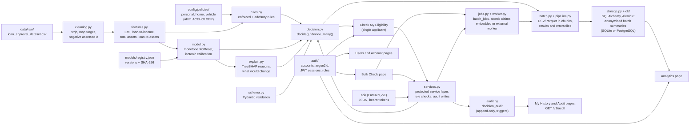

# LoanLens, explained

LoanLens is an independent proof of concept by Anshu Raj. It is not affiliated with or endorsed by any bank or lender. It is a prototype for learning and demonstration, not a lending decision, and it uses public synthetic data only.

This document has two parts. Part 1 is for anyone; it uses no jargon. Part 2 is for technical readers.

## Contents

**[Part 1: The project in plain English](#part-1-the-project-in-plain-english)**
1. [The problem](#the-problem)
2. [What LoanLens does](#what-loanlens-does)
3. [Two short stories](#two-short-stories)
4. [The data](#the-data)
5. [How a decision is made](#how-a-decision-is-made)
6. [Different kinds of loan](#different-kinds-of-loan)
7. [Keeping a record](#keeping-a-record)
8. [Signing in](#signing-in)
9. [A record of every decision](#a-record-of-every-decision)
10. [Connecting other systems](#connecting-other-systems)
11. [Checking very long lists](#checking-very-long-lists)
12. [Where LoanLens can run](#where-loanlens-can-run)
13. [What the colours and labels mean](#what-the-colours-and-labels-mean)
14. [What LoanLens is not](#what-loanlens-is-not)
15. [Honest limits](#honest-limits)
16. [What a real lender would need to add](#what-a-real-lender-would-need-to-add)
17. [Glossary](#glossary)

**[Part 2: Technical deep dive](#part-2-technical-deep-dive)**
1. [Architecture](#1-architecture)
2. [Data](#2-data)
3. [Feature engineering and EMI](#3-feature-engineering-and-emi)
4. [Policy rules engine](#4-policy-rules-engine)
5. [Modelling](#5-modelling)
6. [Explainability](#6-explainability)
7. [Decision engine](#7-decision-engine)
8. [Batch pipeline](#8-batch-pipeline)
9. [UI and theme](#9-ui-and-theme)
10. [Testing](#10-testing)
11. [Benchmark](#11-benchmark)
12. [Accounts and roles](#12-accounts-and-roles)
13. [Service layer, audit trail and REST API](#13-service-layer-audit-trail-and-rest-api)
14. [Security and privacy](#14-security-and-privacy)
15. [Assumptions, placeholders and future work](#15-assumptions-placeholders-and-future-work)
16. [Deployment: packaging, Docker and hosted mode](#16-deployment-packaging-docker-and-hosted-mode)

---

# Part 1: The project in plain English

## The problem

When people apply for a loan, they often do not know whether the lender will say yes. If the answer is no, they are rarely told why, or what they could do about it.

Lenders have a problem too. Staff spend time on applications that were never going to pass. That time could go to the cases that really need a person to look at them.

## What LoanLens does

Think of a friendly pre-check at the bank counter. You show your basic details. In a few seconds you hear: "This looks likely to be approved", or "This looks unlikely, and here is why. If your credit score were a little higher, it would probably go through."

That is LoanLens. It gives:

- a clear answer: **Approved** or **Rejected**;
- how confident it is, in words such as "Very likely" or "Unlikely";
- the **reasons**, in plain language;
- **what would likely change** a "no" into a "yes".

## Two short stories

**Priya checks herself.** Priya fills in a short form: her credit score (480), her income, the loan she wants and what she owns. She presses "Check eligibility". A red banner says **Rejected**. Underneath, it explains: "CIBIL score 480 is below the minimum 550." It adds a tip: paying every bill on time usually improves a credit score over a few months. And it says: "Raising your CIBIL score to about 550 would likely change the result." Priya now knows exactly what to work on. She had signed in with her own account first, so the check is saved to her own history, which only she can see.

**Ravi checks a whole list.** Ravi is a branch manager. He has a spreadsheet with 1,000 loan applicants. He signs in with his bank manager account and uploads the file. LoanLens tells him that 20 rows have mistakes (a missing loan term, a word where a number should be) and lists each one with its row number, so he can fix them. It checks the other 980 in about a second: 547 look likely to be approved, 433 likely to be rejected, and 80 are close calls marked for a person to review. Every rejected row has its reasons. Ravi downloads the results as a spreadsheet.

(Priya and Ravi are made up. Ravi's file is the project's computer-generated test file, not real people.)

## The data

LoanLens learned from a free, public practice dataset found on Kaggle, a website where people share data for learning. It has 4,269 made-up loan applications from India: amounts in rupees, credit scores from 300 to 900, and whether each application was approved.

The data is **artificial**. It was generated by a computer to look realistic. No real customer's information is used anywhere in this project.

## How a decision is made

LoanLens works in four plain steps:

1. **It checks your details make sense.** A loan of zero rupees, or a credit score of 1,000, gets a friendly "please fix this" message instead of an answer.
2. **It checks the basic rules.** For example: is the credit score at least 550? Is the loan no more than 4 times your yearly income? If a basic rule fails, the answer is "Rejected", and that rule is given as the reason.
3. **It compares you with past examples.** A pattern-finding program (a "model") learned from the past applications which kinds of profile were usually approved. It gives a likelihood, from very unlikely to very likely.
4. **It explains itself.** It shows which of your details helped or hurt the most, compares each with typical approved applicants, and works out the smallest change that would probably flip a "no".

## Different kinds of loan

You can choose what the loan is for: a **personal loan** (the starting choice), a **home loan** or a **vehicle loan**. Each kind has its own basic rules. A home loan may be paid back over up to 30 years and may be up to 6 times your yearly income. A vehicle loan must be paid back within 7 years and may be at most one and a half times your yearly income. Each kind also assumes a different interest rate when it works out the monthly payment.

Choosing a kind of loan changes **only the basic rules**. It does not change the pattern-finding program, which learned from one set of made-up applications that never said what each loan was for. All of these rules are examples, not any lender's real rules.

## Keeping a record

Every answer notes which set of rules and which version of the pattern-finding program produced it, so it can always be traced back. LoanLens keeps a list of every version of the program it has ever made, with a fingerprint of each one. If the program's file has been changed by accident, the fingerprint no longer matches and LoanLens refuses to use it.

When a bank manager checks a whole list of applications, LoanLens also saves a short summary (how many were approved and rejected, and the most common reasons). Everything it saves can go into a small file on the computer or into a larger shared database.

## Signing in

There are two kinds of account. Anyone can make an **applicant** account with an email address and a password, and use it to check their own details. **Bank manager** accounts can only be set up by the person running LoanLens or by another bank manager. Only managers can check a whole list, see the overall figures and look after the accounts.

LoanLens keeps very little about each person: the email address, a scrambled form of the password that cannot be turned back into the password, the kind of account, and when it was made and last used. It also keeps a short note of each sign-in and account change, without the email address or password.

Some simple protections are built in. Passwords must be at least 10 characters and must not be an easy, well-known one. After 5 wrong tries in a row, the account is locked for 15 minutes. When something is wrong at sign-in, the message never says whether it was the email or the password. Anyone can delete their own account at any time.

There are honest limits too. LoanLens does not check that an email address really belongs to the person. If someone forgets their password, a bank manager gives them a temporary one, which they must change straight away. And refreshing the page signs you out, so you sign in again. Changing your password signs you out everywhere else, so an old sign-in that someone else might have copied stops working.

## A record of every decision

Every answer LoanLens gives is written down in a permanent record: the details that were entered, the answer, and which rules and which version of the pattern-finding program were used. This happens for answers on the website, answers to other computer programs and every row of a list a bank manager checks. If the record cannot be written, LoanLens does not show the answer.

Nobody can change or remove an entry afterwards, not even the people running LoanLens: the storage itself refuses. The record never contains a name or email address, only a random code for the account.

Applicants can see their own past checks on a **My History** page and download them, and nobody else's. Bank managers can look through all the records, narrow them down by date, answer, kind of loan and so on, and download them. If someone deletes their account, their past checks stay in the record, but the random code no longer leads back to them.

## Connecting other systems

Besides the web pages, LoanLens has a doorway for other computer programs (called an API), for example a lender's own application system. Programs sign in in the same way, get exactly the same answers as the website, and every answer is recorded in the same way. Only bank managers can send a whole list at once or read the record of decisions.

To stop someone guessing passwords, LoanLens slows down anyone who tries to sign in too many times in a short while, both from one computer and for one account. This count starts again whenever LoanLens is restarted.

## Checking very long lists

A bank manager can hand LoanLens a list of up to a million applications at once, as a spreadsheet file. LoanLens does not try to read the whole list in one go. It works through it in slices of 20,000 applications: it checks each slice, writes the answers to a results file and to the permanent record, and moves on to the next slice. Because only one slice is in memory at a time, a very long list needs little more memory than a short one.

The work happens in the background, so the manager can watch a progress bar, do something else, or stop the work part-way. When it is finished, the manager downloads the answers, plus a separate list of any rows that had mistakes, each with its row number so it can be found and fixed.

On the laptop LoanLens was built on, a list of one million made-up applications took between about 11 and 14 minutes, and the memory it used was about the same as for a list of one hundred thousand.

The uploaded list and the answer files are kept in a private place under made-up names, never the names the manager gave them. The uploaded list is removed as soon as the work ends, and the answer files, which can contain the manager's own reference numbers for applicants, are removed after 7 days. If the work is stopped part-way, the answers already written to the permanent record stay there, because nothing can be removed from it.

## Where LoanLens can run

LoanLens can run in three ways.

- **On one computer**, for trying it out. Everything is kept in one small file on that computer.
- **In "containers"** (Docker): a standard way of packing a program with everything it needs, so it runs the same on any computer that supports it. Here LoanLens runs as several parts side by side: the website, the doorway for other programs, a helper that works through long lists, and a proper database that many parts can use at once. One short command starts them all, and another stops them.
- **On a free hosting website**, as a demonstration that anyone with the link can open. Such sites give little memory and forget their files whenever they restart, so LoanLens is careful there: it checks smaller lists (at most 200,000 applications at a time), it needs a separate database somewhere else to remember accounts and the record of decisions, and a list being checked during a restart has to be sent again. It asks for made-up data only and shows that request on the page.

Wherever it runs, LoanLens does not need the original data files: it brings the trained pattern-finding program and a small summary of the data (counts and percentages only, not a single applicant) with it. It also refuses to start in the container or hosted set-ups if its secret key is missing or looks like an easy-to-guess example.

## What the colours and labels mean

| What you see | What it means |
|---|---|
| **Green, Approved** | The application looks like those that were approved. |
| **Red, Rejected** | The application looks like those that were rejected, or a basic rule failed. |
| **Amber, Borderline** | A close call. A person should take a second look ("manual review recommended"). The answer is still Approved or Rejected. |
| **Very likely** (85% or more), **Likely** (65 to 85%), **Borderline** (35 to 65%), **Unlikely** (15 to 35%), **Very unlikely** (under 15%) | How confident LoanLens is that the application would be approved. It never says 0% or 100%, because nothing is certain. |

Colour is never the only signal: the status is always written as a word too ("Approved", "Rejected", "Borderline - manual review recommended"), and each policy check says "Passed" or "Failed".

## What LoanLens is not

- It is **not a real lending decision**. Only a lender can make that.
- It does **not predict who will fail to repay** a loan. It only looks at whether similar applications were approved. Whether someone later repays is a different question, and this data cannot answer it.
- It uses **no real customer data**.

## Honest limits

- **The practice data is artificial.** Patterns in it come from how it was generated, not from real borrowers.
- **The credit score decides almost everything** in this data. About 99 in 100 applicants with a score above 550 were approved, and only about 1 in 10 at or below it.
- **The limits are placeholders.** The minimum score of 550, the "4 times income" limit and the others are illustrative examples. A real lender would replace them with its own policy.
- **There are odd quirks** in the data. For example, short loans with low credit scores were often approved. LoanLens is built never to give advice based on those quirks, such as "borrow more" or "take a shorter loan".

## What a real lender would need to add

- Its **own policy limits** (minimum credit score, income and asset limits, and so on).
- **Real repayment records**, to predict who is likely to repay, not just who was approved.
- A link to its **own staff login system**, a check that each email address is real, and its own secure, backed-up storage for the record of decisions.
- A **legal, compliance and fairness review** before using it with real customers.

## Glossary

| Word | Meaning |
|---|---|
| **CIBIL score** | A credit score used in India, from 300 to 900. Higher means a better record of repaying loans and bills on time. |
| **EMI** | Equated Monthly Instalment: the fixed amount you repay each month, covering both the loan and the interest. |
| **Collateral / assets** | Things you own, such as a home, a shop, a car, jewellery or savings. They show the lender you have resources behind the loan. |
| **Loan term** | How many years you take to repay the loan. |
| **Approval likelihood** | How confident LoanLens is that an application like yours would be approved, shown as a percentage and a word. |
| **Model** | A computer program that learned patterns from past examples, and uses them to judge a new case. |
| **Calibration** | Tuning a model so that its percentages mean what they say: of all the applications it calls "80% likely", about 80% really were approved. |
| **Explainability** | Being able to say *why* the program gave its answer, in terms a person understands. |
| **Borderline** | A close call, where a person should review the case before anything is decided. |
| **Batch** | A whole list of applications checked in one go, usually uploaded as a spreadsheet (CSV file). |
| **Account** | Your email address and password, which let LoanLens know who you are and which pages you may use. |
| **Audit trail** | The permanent record of every decision, which nobody can change or delete. |
| **API** | A doorway that lets other computer programs ask LoanLens for answers directly, without the web pages. |

---

# Part 2: Technical deep dive

## 1. Architecture

The REST API and the batch worker (`python -m loanlens.worker`, or an embedded thread) call the same service layer and decision core; in Docker they run as separate containers sharing one PostgreSQL database and one jobs volume (section 16). The Streamlit pages in `app/` contain layout only; every decision, rule, explanation and text template lives in `src/loanlens/`. All thresholds come from the policy profiles in `config/policies/`. The pages and the REST API call only the protected service layer (`services.py` and `auth/`), which checks the signed-in user's role and writes the audit record; Streamlit calls it directly in the same process rather than through the API (a documented choice that keeps the app simple to run and host).

## 2. Data

| File | Rows | Role |
|---|---|---|
| `loan_approval_dataset.csv` | 4,269 | **Primary.** Powers the app. INR, CIBIL 300-900, 62.2% approved. |
| `bank_loan_data.csv` | 45,000 | **Benchmark only**, never merged (section 11). |
| `loan_data.csv` | 381 | Sanity check only. Source not verified. |

None of them is committed; see the README for the Kaggle links. The primary data is synthetic.

**Cleaning** (`cleaning.py`, audited in `notebooks/01_audit.ipynb`):

| Issue | Count | Action |
|---|---|---|
| Column names with stray whitespace | 12 of 13 | Stripped, normalised to snake_case |
| Text cells with stray whitespace | 12,807 | Stripped |
| Missing values / duplicate rows | 0 / 0 | None needed (pipeline still drops exact duplicates) |
| Negative `residential_assets_value` (all exactly -1,00,000; 16 approved, 12 rejected) | 28 | Set to 0 (`clip_zero`, configurable as `drop` or `nan`) |
| IQR outliers in asset columns | 94 | Kept: plausible high values |
| Target as text | 4,269 | Approved = 1, Rejected = 0 |
| `loan_id` | 1 column | Dropped |

**EDA findings** (`notebooks/02_eda.ipynb`):

- **CIBIL dominates.** 99.5% (2,467 of 2,480) are approved above CIBIL 550 and 10.6% (189 of 1,789) at or below. A one-split tree on CIBIL alone gets 95.4% accuracy (split learned at 549.5).
- **No effect:** education, self-employment and number of dependents (spreads of 0.5, 0.03 and 3.9 points; chi-square p = 0.77, 1.00, 0.78). They are not model features.
- **Quirk 1:** 186 of the 189 low-CIBIL approvals (98.4%) have a loan term of 2 or 4 years.
- **Quirk 2:** inside that low-CIBIL, short-term group, approval is 0% at loan-to-income of 2.5 or below and 96-100% above 3.0, the opposite of sound lending logic.
- **Narrow ranges:** loan-to-income 1.50-4.00, term 2-20 years (even values only), income Rs 2,00,000-99,00,000. Inputs outside these ranges get a warning.
- A random forest reaches 98.2% accuracy on raw features and 99.6% once loan-to-income is added (5-fold CV).

## 3. Feature engineering and EMI

`features.py` computes:

- `total_assets` = residential + commercial + luxury + bank assets;
- `loan_to_income` = loan amount / annual income;
- `loan_to_assets` = loan amount / total assets;
- `emi` with the standard reducing-balance formula:

  EMI = P × r × (1 + r)^n / ((1 + r)^n − 1), where P is the loan amount, r = annual rate / 12 and n = term in years × 12;

- `emi_to_income` = EMI / (annual income / 12).

The dataset has no interest rate, so **r uses an assumed 10% a year (`emi.assumed_annual_interest_rate`, a PLACEHOLDER)**. EMI is used only by the advisory EMI rule, never by the model. Zero income, zero assets and a zero term are handled without errors (infinite ratios fail the rule with a plain message).

## 4. Policy rules engine

Each rule in a policy profile has a `value` and an `enforce` flag, validated by `config.py`. The table shows the default `personal` profile, which reproduces the original `config/policy.yaml` exactly. An enforced failure means **Rejected, whatever the model says**; an advisory failure only adds a warning. A value exactly at a threshold passes.

| Rule | Value | Enforced | Data-based reasoning |
|---|---|---|---|
| `min_cibil` | 550 | Yes | Where approval falls from about 99% to about 10%. Rejects 185 applicants (7.0%) approved in the data, all from the synthetic short-term quirk; overriding them is intended. **Always overrides the model.** |
| `max_loan_to_income` | 4.0x | Yes | Fails 0% of approved applicants (data maximum is 4.0); guards against out-of-range input. |
| `max_loan_to_assets` | 1.5x | Yes | Fails 0% of approved applicants (data maximum about 1.33). |
| `min_loan_term_years` / `max_loan_term_years` | 2 / 20 | Yes | The data range. |
| `max_emi_to_income` | 50% | **No (advisory)** | Would fail 47.4% of approved applicants (1,260 of 2,656) at the assumed rate, so enforcing it would contradict the data. A real FOIR policy and real rates are needed. |

Rule of thumb for the enforce flags: a ratio rule is enforced only if it fails fewer than 5% of approved applicants; a test fails if config and data ever disagree. `python -m loanlens.rules` writes `reports/rules_vs_labels.md`.

**Policy profiles.** `config/policies/` holds one YAML file per loan type (`personal`, `home`, `vehicle`), each with `profile`, `version` (semantic version, validated), `description` and the rule, EMI, model and display settings. `load_profile(name)` validates the name (lower-case letters, digits, underscore; anything else, including path tricks, is an `UnknownProfileError` that lists the valid names), loads and caches the file, and computes `content_hash`: the SHA-256 of the validated settings as canonical JSON, so comments and spacing do not change it but any value does. `load_policy()` returns `personal`, so older code is unchanged. Home differs by term 5-30 years, loan-to-income 6.0x, loan-to-assets 2.0x and an assumed 8.5% rate; vehicle by term 1-7 years, 1.5x, 1.0x and 11%. The model settings (threshold, borderline band and margin) are the same in every profile. The batch, storage and cleaning sections are app-wide and read from `personal`.

Profiles change rules and assumptions only, never the model, which has no loan-type feature. Values a profile allows but the model never saw (terms above 20 years, loan-to-income above 4.0) trigger the existing out-of-range warning.

## 5. Modelling

`model.py` builds sklearn Pipelines (preprocessing fitted inside each fold), compares models with stratified 5-fold CV (seed 42) and saves the final artifact with its feature list, version, training ranges and benchmarks.

**Comparison (unconstrained):**

| Model | Feature set | ROC-AUC | PR-AUC | F1 |
|---|---|---|---|---|
| Logistic regression | compact | 0.9689 | 0.9802 | 0.9322 |
| Random forest | compact | 0.9989 | 0.9992 | 0.9970 |
| XGBoost | compact | 0.9992 | 0.9995 | 0.9957 |
| XGBoost | all columns + loan-to-income | 0.9993 | 0.9996 | 0.9955 |

Compact features: `cibil_score`, `loan_term`, `loan_to_income`, `income_annum`, `total_assets`. Gender and marital status are blocked in code (and absent from the data).

**Monotone constraints.** Unconstrained, the model learns quirk 2: raising every loan by 25% *raised* approval for 41% of low-CIBIL short-term rows. Constraining CIBIL (+) and loan-to-income (−) and removing raw `loan_amount` (otherwise the model rebuilds the ratio and bypasses the constraint) brings that to 0%. **Cost:** 0.40 ROC-AUC points (0.9992 to 0.9952); F1 against the raw labels drops from 0.996 to 0.964, but entirely in rows the CIBIL rule rejects anyway, so for the full rule + model decision F1 is 0.9611 constrained vs 0.9609 unconstrained.

**Calibration** (constrained XGBoost):

| Method | ROC-AUC | Brier | Log loss |
|---|---|---|---|
| None | 0.9952 | 0.0275 | 0.0868 |
| Sigmoid (Platt) | 0.9952 | 0.0310 | 0.1143 |
| **Isotonic (chosen)** | 0.9942 | 0.0257 | 0.0803 |

**Choice.** The simplest model within about 1% ROC-AUC of the best: logistic regression is more than 2.5 points behind; constrained XGBoost and constrained random forest tie at 0.9942, and XGBoost is far smaller (about 3,000 leaves vs about 30,000). **Final CV metrics:** ROC-AUC 0.9942, PR-AUC 0.9946, precision 0.9527, recall 0.9759, F1 0.9639, accuracy 0.9546, Brier 0.0257.

**Ablations and leakage checks** (XGBoost, compact, unconstrained):

| Setting | ROC-AUC |
|---|---|
| All compact features | 0.9992 |
| CIBIL only | 0.9603 |
| Without CIBIL | 0.5837 |
| Without loan term | 0.9822 |
| Without loan-to-income | 0.9948 |
| **Shuffled labels** | **0.499** (chance) |

No identifier or target-derived feature is used and there are no duplicate rows. The near-perfect scores come from the near-deterministic synthetic label, not from leakage. Feature importance (mean absolute SHAP share): CIBIL 57%, loan term 19%, total assets 12%, income 7%, loan-to-income 4%.

**Model registry.** `models/registry.json` (validated with Pydantic in `registry.py`) lists every version with `version`, `created_at`, `training_data_hash` (SHA-256 of the processed CSV), `features`, `cv_metrics`, `artifact` (`loanlens_model_<version>.joblib`), `artifact_sha256`, `artifact_bytes` and `status`; exactly one entry is `active`. `python -m loanlens.model` cross-validates, trains, saves a new version (next minor version by default, or `--version`), registers it and activates it unless `--no-activate` is given; older artifacts are kept. `--list` prints the registry and `--activate <version>` switches the active version after verifying its file. `load_artifact()` picks `LOANLENS_MODEL_VERSION` or the active version, compares the file's SHA-256 with the registry and raises `ArtifactIntegrityError` on a mismatch. The pre-registry `models/loanlens_model.joblib` was migrated once: renamed to `loanlens_model_1.0.0.joblib` with identical bytes (SHA-256 `49b800ef9416...`), so predictions are unchanged. Writes are atomic (temporary file, then replace).

## 6. Explainability

`explain.py` uses **TreeSHAP** on the calibrated model's single base estimator.

- **Rule reasons** come first and are exact: "CIBIL score 480 is below the minimum 550."
- **Model reasons** are negative SHAP drivers with |SHAP| ≥ 0.25 log-odds, ranked by size. Each becomes a plain-English sentence with *your value* vs a *benchmark* (the median approved applicant, saved in the artifact) and a suggestion. A value is called a weakness only if it is on the weaker side of that median, so a high income is never blamed. Drivers already covered by a failed rule are dropped. At most 5 reasons; a fallback reason guarantees every rejection has at least one.
- **Loan term is never a reason** or a positive factor, because its effect comes from the synthetic quirk.
- **Positive factors** (approvals only): up to 3 positive drivers, at least 1.
- **What would change:** two one-feature-at-a-time searches, each re-running the full decision (rules + model): raise CIBIL in steps of 5 up to 900, or reduce the loan from 99% to 10% of the request in 1% steps. Because the model is monotone, the first flip is also the smallest. It is worded "would likely", never "guaranteed". **It never suggests borrowing more or changing the term** (both enforced by tests). If no single safe change would help, it says so.

## 7. Decision engine

`decision.py` is the single source of truth. `decide_many()` is a **vectorised core** (features, rules, one `predict_proba` call, SHAP on the whole batch, and candidate scoring for "what would change" in one model call). `decide()` validates one applicant and calls the same core with one row, so customer mode and Bulk Check are identical by construction.

For each application: validate → rules → model probability `p` → Approved if no enforced rule failed and `p` ≥ 0.5 → borderline flag → reasons, positive factors, changes and warnings. The output `DecisionResult` holds `status`, `probability`, `borderline`, `reasons`, `what_would_change`, `rule_results`, `warnings` and `positive_factors`, plus the provenance fields `profile`, `policy_version`, `policy_hash` and `model_version`. `decide()` and `decide_many()` take an optional `profile` (an explicit `policy` object wins).

**Borderline** ("manual review recommended") is set when (no enforced rule failed and 0.4 ≤ `p` ≤ 0.6) or (CIBIL within ±25 points of `min_cibil` and no *other* enforced rule failed). A manual review cannot override a different hard rule, so that case is not flagged.

**Display bands.** The score never reads 0% or 100% (">99%" / "<1%") and carries a verbal band: Very likely ≥ 85%, Likely ≥ 65%, Borderline ≥ 35%, Unlikely ≥ 15%, else Very unlikely. The verbal "Borderline" band is deliberately wider than the borderline flag band; both are settings in the policy profiles.

## 8. Batch pipeline

Since Milestone 4 every Bulk Check upload and every `POST /v1/batches` request is a **background job**, processed by a chunked, memory-safe pipeline.

- **Reading** (`batch.ChunkReader`): CSV through `pandas.read_csv(chunksize=...)` (delimiter detected from the header line: comma, semicolon, tab or pipe; the whole file is checked for UTF-8 first, with a cp1252 fallback; blank lines skipped; a malformed line fails the file) and Parquet through `pyarrow`'s `iter_batches`, reading only the recognised columns and turning them into text so the same validation applies (a missing value is a blank cell, which is an error, never 0). The format is detected from the content. Chunks are 20,000 rows by default (`LOANLENS_JOB_CHUNK_SIZE`). The header is checked before any row is scored.
- **Headers:** normalised (case, spaces) and mapped through an alias table (e.g. "Income" → `income_annum`, "Tenure" → `loan_term`). Missing required columns are named exactly; duplicates that map to the same column are an error; unknown columns are ignored.
- **Row validation:** vectorised, using the same limits and messages as the customer form (read from the Pydantic schema so they cannot drift). Amounts like "12,50,000" or "Rs 5,00,000" are accepted. Bad rows are reported with their original row numbers (numbering continues across chunks) and skipped.
- **Loan type:** the job's chosen profile, or an optional `product` column per row (an unknown value is a row error). Within each chunk, rows are grouped by product and each group is decided under its own profile; output order is preserved.
- **Per chunk** (`pipeline.run_file`): `batch.score()` (the shared `decide_many()` core) → audit records in bulk inserts (`audit.batch_rows` + `audit.write`, 1,000 per insert) → append to `results.parquet` (fixed schema), `results.csv` and the errors CSV → running summary counts → progress callback (heartbeat, counts, cancel check). Audit records are written before the chunk's results reach a file. Decisions are identical to the previous in-memory path: a golden file captured before the change is compared column by column at several chunk sizes.
- **Jobs** (`jobs.py`, table `batch_jobs`, Alembic `0004_batch_jobs`): status `queued` → `running` → `completed`, `failed` or `cancelled` (and `expired` once the retention clean-up has deleted the files). The worker claims the oldest queued job atomically: `SELECT ... FOR UPDATE SKIP LOCKED` then `UPDATE` on PostgreSQL; a single conditional `UPDATE ... WHERE status = 'queued'` with a claim token on SQLite. All later updates require the job to be running under the same worker id. Cancel: a queued job at once; a running job after its current chunk.
- **Worker** (`worker.py`): `python -m loanlens.worker` (or `--once`, `--cleanup`), or an embedded daemon thread started by the Streamlit app and the API when no external worker has sent a heartbeat recently (`LOANLENS_EMBEDDED_WORKER`). It needs no session token: the submitting manager's `audit_ref` is stored on the job at submission and checked against an active manager account before the job runs. Running jobs without a heartbeat for 300 s are failed at start-up and every minute afterwards.
- **Files:** private `LOANLENS_JOBS_DIR` (default `data/jobs/`), random 32-hex names, only that pattern accepted and only inside that directory, paths from the job record only. Uploads are deleted when the job ends; results after `LOANLENS_JOB_RETENTION_DAYS` (7).
- **Storage:** a completed job writes one anonymised summary row (counts, approval rate, likelihood-band counts, top rejection reason codes, model version) for Analytics. No IDs, names or input values unless `storage.store_applicant_ids` is turned on (it is off); if it is, per-row IDs are read back from the Parquet file in batches.
- **Measured speed and memory:** see [reports/performance.md](reports/performance.md). Each configuration was measured once, on one laptop, with PostgreSQL in a local container and (for the load test) the load generator on the same machine; SQLite is for local demos, and multi-process deployments need PostgreSQL. On 2026-11-06 (i7-11800H laptop): 1,000,000 synthetic rows in 663.7 s on PostgreSQL and 833.5 s on SQLite with audit on (525.9 s and 633.3 s with audit off); peak memory 457 to 527 MB at every size from 100,000 to 1,000,000 rows. Profiling one 20,000-row chunk showed about 60% of scoring time in explanation work (the "what would change" search and SHAP). API load test: [reports/load_test.md](reports/load_test.md) (1 worker levels off at about 18 to 23 scores a second; 4 workers on PostgreSQL served 81 a second at 100 users, p50 93 ms).

**Database layer.** `src/loanlens/db/` holds the SQLAlchemy 2 engine and session handling (`engine.py`) and the tables (`models.py`: the ORM class `BatchSummary` and the Core table `batch_rows`, both identical to the original `sqlite3` schema). The URL comes from `DATABASE_URL`, defaulting to `sqlite:///data/loanlens.sqlite`; `postgresql://` URLs are switched to the psycopg driver, and PostgreSQL connections time out after 5 seconds. The schema is managed by Alembic (`db/migrations/`, revisions `0001_initial`, `0002_auth`, which adds `users` and `auth_events`, `0003_audit`, which adds `decision_audit` with its append-only triggers and `users.token_version`, and `0004_batch_jobs`, which adds `batch_jobs` and `batch_workers`); `ensure_schema()` runs `upgrade head` once per URL per process, and the initial migration skips tables that already exist, so databases created by the old code are adopted without data loss. Every driver error becomes a `DatabaseError` with a plain message that never contains the URL or a password; a completed batch job whose summary cannot be saved still completes, with a note. Tests run on SQLite always and on PostgreSQL when `LOANLENS_TEST_POSTGRES_URL` is set. Running migrations from code never changes the process's logging: `ensure_schema()` sets a `skip_logging_config` attribute, and `env.py` applies alembic.ini's logging section only for the `alembic` command, without disabling existing loggers.

## 9. UI and theme

Ten Streamlit pages: Home, Sign in, Check My Eligibility, Bulk Check, Analytics, About, Users, Account, My History and Audit. Home, Sign in and About are public; Check My Eligibility, My History and Account need any signed-in user; Bulk Check, Analytics, Audit and Users need the manager role. `app/ui_common.py` adds the header strip (the title "LoanLens" only), the sidebar (with the signed-in email, role and a Sign out button), prototype notice and footer to every page, re-validates the session on every page load, stops a page with a plain message and a Sign in link when access is missing, and turns errors (missing model, model file that fails its hash check, bad policy file) into friendly messages; the customer form has a **Loan type** selector and the About page lists every profile's values side by side and every registered model version; `.streamlit/config.toml` hides stack traces.

`src/loanlens/theme.py` is the single home for every colour, the status-to-colour mapping, the CSS and the Plotly template. Approved is green, Rejected red, borderline amber, neutral series blue, on a white background.

**Accessibility:** contrast is checked against WCAG AA in tests. Brand colours are used for borders, chart marks and large headings; small coloured text uses darker shades (green `#157A45`, red `#B42318`, amber `#8A5A12`, blue `#1D5FCF`), each at least 4.5:1. Status is never shown by colour alone: there is always a plain word as well. The app uses no emoji or icon characters (a test enforces this).

## 10. Testing

790 passing and 2 skipped with a PostgreSQL test database (both skips are PostgreSQL-only checks in their SQLite variant), or 779 passing and 13 skipped without one (pytest), 98% coverage of `src/loanlens`, `ruff` clean. The PostgreSQL tests, including job claiming with `SKIP LOCKED`, ran and passed against PostgreSQL 16.15 on 2026-11-06 and again on 2026-11-07. On a fresh clone with no dataset and no PostgreSQL: 759 passed, 33 skipped. Categories:

- cleaning, features and EMI, each policy rule and its thresholds (including values exactly at each limit), config validation;
- schema validation and friendly messages;
- modelling (protected attributes blocked, determinism, save/load, monotonicity of the saved model);
- decision orchestration (**every rejection has a non-empty reason**, enforced rules override the model, suggestions only raise CIBIL or lower the loan and actually flip the result, a decision in under 2 seconds);
- batch validation (good CSV, bad rows, missing columns, empty, BOM-only and header-only files, other delimiters, aliases, too many rows, 1,000 rows in 10 s or less);
- the **single-versus-batch consistency test**: 600 rows of the test file give exactly the same status, probability (within 1e-6), reasons and borderline flag through `decide()` and through the batch path;
- storage anonymity, theme and contrast, the benchmark notebook's isolation, and headless page tests (Streamlit AppTest) for every page;
- the database layer (migrations, round trip, legacy databases, URL handling, friendly errors; on PostgreSQL too when configured), policy profiles (personal reproduces the six example decisions, each profile's rules apply, unknown profiles, the content hash, the `product` column) and the model registry (round trip, activation, environment override, hash mismatch, legacy migration, CLI, unchanged predictions);
- authentication (`tests/test_auth.py`, `tests/test_auth_pages.py`): argon2id hashing, the password policy and email checks, lockout and unlock (at a given time), token expiry and tampering (bad signature, edited payload, `alg: none`, missing claims, role mismatch), role enforcement in the service layer (including a hand-built principal), manager actions, bootstrap and the CLI, account deletion, and AppTest flows (register, sign in, wrong password, applicant blocked from manager pages, manager allowed, sign out, expired session, forced password change). One test scans the database file, the `auth_events` rows and the captured logs for every password and token used and finds none;
- session invalidation (a stolen old token is rejected after a password change, a temporary password, deactivation or reactivation, while the changing session gets a fresh token; the `ver` claim is required);
- the service layer (`tests/test_services.py`): every protected function with no principal, a hand-built principal (applicant and manager), an applicant and a manager, plus a scan that no page calls the decision core, storage or audit internals directly;
- the audit trail (`tests/test_audit.py`): triggers reject `UPDATE` and `DELETE` (raw SQL and ORM), chunked inserts, no update or delete code paths (AST check), records from the UI, API and batch paths, history privacy, account deletion, filters, counts and pagination, and the My History and Audit pages; the trigger tests also run on PostgreSQL when `LOANLENS_TEST_POSTGRES_URL` is set (run and passed on 2026-11-06);
- batch jobs (`tests/test_jobs.py`, `tests/test_api_batches.py`): results identical to the previous batch path (golden file) at chunk sizes 37, 999, 1,000, 1,001 and 20,000; bad rows spread across chunks keep their row numbers; a chunk of only bad rows; Parquet input (text and numeric columns, aliases, missing values); unreadable, header-only, binary and fake-Parquet files; a malformed line part-way; the row limit; audit rows per chunk; settings and their validation; random file names and rejected path traversal; the upload limit; the job lifecycle, cancel while queued and while running (audited rows kept), failure messages, a deactivated manager's job, audit switched off, stale jobs failed at start-up, retention clean-up, the worker CLI and the embedded worker; **two workers never claim the same job** (6 threads, 40 jobs, on SQLite and on PostgreSQL) and a direct `SKIP LOCKED` check on PostgreSQL; every `/v1/batches` endpoint with roles, downloads and errors; and a **memory test** that streams a generated 200,000-row file and checks that peak memory grows by less than 200 MB;
- the REST API (`tests/test_api.py`, httpx test client): authentication on every protected endpoint, roles for every endpoint, the API result identical to the service layer for all six examples under all three loan types, batch results, audit rows with the request id, pagination and filters, the OpenAPI schema, health and readiness, one error shape, CORS, rate limits per client address and per account, and JSON logs without personal data.

- hosted mode and deployment (`tests/test_hosted.py`, `tests/test_analytics.py`, `tests/test_healthcheck.py`): Streamlit secrets, weak and missing secrets refused in hosted mode, bootstrap checks, the ephemeral-database warning, hosted job defaults, the Bulk Check notice, project-root resolution, `python -m loanlens.db`; the committed aggregates file (no row-level data, equal to a fresh build, identical charts either way, importance only for its own model, broken or missing files) and the Analytics page without the data folder; the container health checks and the worker heartbeat during a long job.

The 1,000-row test file is fully synthetic (`scripts/make_batch_fixture.py`), with 20 deliberately bad rows. Tests that need the Kaggle data or the model skip themselves cleanly on a fresh clone.

## 11. Benchmark

`notebooks/04_benchmark_bank_loan_data.ipynb` repeats the modelling on the 45,000-row `bank_loan_data.csv` (22% approved, FICO-style scores, amounts that look like US dollars). Gender and age are excluded. XGBoost reaches ROC-AUC 0.978 there.

- **Different dominant feature:** in the primary data CIBIL dominates; in the benchmark, **a previous loan default** dominates (SHAP share 58%), and **credit score alone is no better than chance** (ROC-AUC 0.501; removing it changes ROC-AUC from 0.978 to 0.977).
- **Label caution:** approval there rises with interest rate and loan-to-income, which looks like a default label; the Kaggle page itself describes the label as repaid/defaulted.
- **Conclusion:** each synthetic dataset follows one rule-like field. A real system needs previous defaults, employment experience, home ownership, loan purpose, the offered rate and existing EMIs. Full comparison: [reports/benchmark.md](reports/benchmark.md).

## 12. Accounts and roles

`src/loanlens/auth/` is the service layer for accounts; the pages only call it.

- **Tables** (Alembic `0002_auth`): `users` (id, `audit_ref` as a separate random UUID for pseudonymous records, email unique and lower-case, `password_hash`, role `applicant` or `manager` with a check constraint, `is_active`, `must_change_password`, `created_at`, `last_login_at`, `failed_attempts`, `locked_until`) and `auth_events` (`occurred_at`, `user_id`, `actor_id` for manager actions, `event_type`, `success`, `reason`). Both event links are cleared when an account is deleted.
- **Passwords** (`passwords.py`): argon2id through argon2-cffi with its defaults (RFC 9106 low-memory profile); hashes are refreshed at sign-in if the parameters change. Policy: 10 to 128 characters, not in `common_passwords.txt` (about 130 entries, including the old demo password), not equal to the email. Emails are validated with a regular expression (no extra dependency) and lower-cased.
- **Sign-in** (`service.sign_in`): one generic error for every failure. Unknown and malformed emails still run a dummy argon2 check, so timing does not reveal whether an account exists. After `LOANLENS_LOCKOUT_ATTEMPTS` (5) wrong passwords the account is locked for `LOANLENS_LOCKOUT_MINUTES` (15); a success or an expired lock resets the counter; inactive accounts are refused.
- **Sessions** (`tokens.py`): HS256 JWT with `sub` (user id), `role`, `ver` (the account's `token_version`), `iat`, `exp` and `iss`, signed with `LOANLENS_JWT_SECRET` (at least 32 characters) and valid for `LOANLENS_SESSION_MINUTES` (60). `principal_from_token` verifies the signature, expiry and required claims, then re-reads the account, which must exist, be active and have the token's role and token version. A password change, a temporary password and deactivation or reactivation raise `token_version`, so every older token stops working; `change_password` returns a fresh session for the caller. Without a secret, development uses a per-process temporary key with a visible warning, and production or hosted mode refuses to start (`ConfigurationError`).
- **Roles:** every service function takes a `Principal` and checks it with `require_role`; `verify_principal` re-loads the acting account from the database and checks the principal's seal (an HMAC over the identity fields and token version, made with the signing key when the principal is issued), so a hand-built or stale principal is refused even if its fields match a real account. Applicants sign up themselves; managers come from `python -m loanlens.auth create-manager` (getpass prompt, never an argument), the one-time `LOANLENS_BOOTSTRAP_MANAGER_*` settings (only while no manager exists, with a logged warning to remove them; the new manager must change the password) or another manager. A manager cannot change their own status, and the last active manager cannot delete their account.
- **Limits:** no email verification, no self-service reset (a manager sets a temporary password, which sets `must_change_password` and clears a lock), and the Streamlit session ends on page refresh because the token lives only in `st.session_state`.

## 13. Service layer, audit trail and REST API

- **Service layer** (`services.py`): `score_applicant` (any signed-in user), `score_records` (managers), `submit_batch_job`, `list_batch_jobs`, `get_batch_job`, `cancel_batch_job`, `batch_job_file` and `batch_job_preview` (managers; any manager sees every job), `save_batch_summary`, `latest_batch_summary`, `recent_batch_summaries`, `training_data` and `feature_importance` (managers, for Analytics), `my_history` (own records only) and `audit_records`, `audit_export`, `audit_filter_options` (managers). Each first calls `auth.verify_principal`; failures raise `AuthorisationError` (`InvalidSession` or `PermissionDenied`). The pages and the API call nothing below this layer, and a test scans the page sources to keep it that way.
- **Audit trail** (`audit.py`, table `decision_audit`, Alembic `0003_audit`): UUID id, `created_at` (UTC), `user_ref` (the account's `audit_ref`), `actor_role`, `channel` (`ui`, `api` or `batch`, check constraint), `batch_id`, `request_id`, profile, policy version and hash, model version, `inputs` (JSON of the eight model input fields only), status, probability, borderline and `reason_codes` (JSON). Rows are written before a result is returned (fail closed); a batch job writes its rows chunk by chunk, before the chunk's results reach a file, with one `batch_id` per job (stored on the job). Records written before a job fails or is cancelled remain. Triggers: SQLite `BEFORE UPDATE` and `BEFORE DELETE` with `RAISE(ABORT, ...)`; PostgreSQL a plpgsql function raised `BEFORE UPDATE OR DELETE FOR EACH ROW` and `BEFORE TRUNCATE`. The module has no update or delete function. Reads filter by date range (inclusive, UTC), status, profile, channel, model and policy version, newest first, with counts.
- **REST API** (`api/`): FastAPI 0.115 served by uvicorn. Endpoints as in README. `ScoreRequest` extends `ApplicantInput` with `product`; `ScoreResponse` extends `DecisionResult` with `likelihood_band`, `likelihood`, `request_id` and `audit_id`. Middleware assigns or keeps a safe `X-Request-ID`, logs one JSON line per request (request id, method, route template, status, duration, role; no personal data or client address) and turns any unhandled error into a 500 without details. Every error is `{"error": {code, message, request_id, details?}}`; validation details name fields but never echo input. Accounts that must change their password get 403 except on `/v1/auth/me`. CORS is added only when `LOANLENS_API_CORS_ORIGINS` is set. `/ready` checks the database (`SELECT 1` after migrations) and the model (hash-verified load). Startup refuses to run without `LOANLENS_JWT_SECRET` in production or hosted mode and runs the one-time manager bootstrap.
- **Rate limits:** an in-memory sliding window on `/v1/auth/login` and `/v1/auth/register`, keyed by client address (default 10 per 60 s) and by a SHA-256 of the lower-cased email (default 5 per 60 s); 429 with `Retry-After`. Refused attempts are not counted, old keys are purged, and the counters reset when the process restarts.

## 14. Security and privacy

- **No default credentials:** the old shared manager password and `LOANLENS_MANAGER_PASSWORD` are gone. Passwords are argon2id hashes; passwords, tokens and email addresses are never logged or written to `auth_events`, and a test checks this.
- **Decisions are audited:** each decision's model inputs, result and versions are stored append-only with a random account reference, never an email or name; applicants see only their own records. What is stored per account is listed in section 12.
- **Bulk Check** also stores anonymised batch summaries, in a local SQLite file or the database named by `DATABASE_URL` (ORM or parameterised statements only; the URL is never logged or shown).
- **Batch files:** uploads and results live in a private, gitignored directory under random names; no path from a client is ever opened or served. Uploads are deleted when the job ends; results and error files (which can contain applicant IDs from the upload) after `LOANLENS_JOB_RETENTION_DAYS` (default 7, `python -m loanlens.worker --cleanup`, also run when a worker starts).
- **Configuration** comes from environment variables (`.env.example` lists the names only); inputs are validated with Pydantic, and database access uses the ORM or parameterised statements only.
- **Docker and hosted mode:** `LOANLENS_ENV=production` (Docker) and `LOANLENS_HOSTED=1` refuse a missing, short or placeholder-like `LOANLENS_JWT_SECRET`, an incomplete or weak bootstrap pair and `LOANLENS_BATCH_AUDIT=off`; the image runs as a non-root user and contains no dataset, `.env` or database; compose publishes nothing but the app and the API, on 127.0.0.1 (section 16).
- **Gitignored:** `data/raw/` and `data/processed/` (third-party data), `data/jobs/` (batch files) and `data/benchmarks/` (generated synthetic files), archived model versions (the registry and the active 0.4 MB artifact are committed), `*.sqlite` / `*.db` (local results), `.env` and `.streamlit/secrets.toml` (secrets), `.venv/`, caches and coverage files.

## 15. Assumptions, placeholders and future work

Every value below is illustrative; a lender would replace it with its own credit policy (full list with reasoning at the top of [reports/decisions_log.md](reports/decisions_log.md)):

- rule thresholds and enforce flags (personal profile): `min_cibil` 550, `max_loan_to_income` 4.0, `max_loan_to_assets` 1.5, loan term 2-20 years (all enforced), `max_emi_to_income` 50% (advisory);
- assumed annual interest rate 10% (personal);
- the home profile (term 5-30 years, 6.0x income, 2.0x assets, 8.5%) and the vehicle profile (term 1-7 years, 1.5x income, 1.0x assets, 11%);
- approval threshold 0.5; borderline band 40-60%; borderline CIBIL margin ±25 points;
- likelihood bands 85 / 65 / 35 / 15%;
- batch job limits: 1,000,000 rows and 200 MB per file, 20,000-row chunks, 7-day retention of result files (all configurable); negative assets set to 0;
- account settings: lockout after 5 failed sign-ins for 15 minutes, 60-minute sessions and the 10-character minimum password length (the first three are configurable);
- API limits: at most 1,000 applicants per batch request, and 10 sign-in or registration attempts per client address and 5 per account in 60 seconds (all configurable).

**Future work:** real policy thresholds; repayment outcome data and a separate default-risk model; integration with origination and bureau systems; email verification and self-service password reset; shared rate limiting for several API processes; a compliance and fairness review; collecting previous defaults, employment experience, home ownership, loan purpose, offered rate and existing EMIs; optional dashboard-ready exports.

## 16. Deployment: packaging, Docker and hosted mode

**Running without the data folder.** Three committed files are enough to run every page: `models/registry.json`, the active artifact `models/loanlens_model_1.0.0.joblib` (about 0.4 MB, hash-checked against the registry) and `data/hosted/analytics_aggregates.json` (about 4 KB). The last is built by `scripts/build_hosted_assets.py` from the cleaned data and the active model: per CIBIL band, loan term and loan-size quintile the number of applications, approvals and the approval rate, plus the mean absolute SHAP share per feature with the model version and training time it belongs to. No row of the dataset is written, and a test checks that the committed file equals a fresh build. `analytics.py` gives the Analytics page the same tables from either source (`charts.approval_rate_chart` draws a table, so the figures are identical, which a test checks); stored importance values are shown only for the model they were computed for. With the data present, local behaviour is unchanged.

**Packaging.** `requirements.txt` lists only the runtime packages (pinned); `constraints.txt` pins every indirect package too, as resolved in a clean Python 3.11 environment. Development tools and `-e .` moved to `requirements-dev.txt`. The package no longer has to be installed in editable mode: `config.find_project_root()` locates `config/`, `models/` and `reports/` from `LOANLENS_HOME`, else the source checkout, else the current directory (a non-editable install started from a clone), and `app/ui_common.py` puts `src/` on the import path when `loanlens` is not installed (a host that only installs `requirements.txt`). The Alembic migrations ship inside the package, and `python -m loanlens.db upgrade` runs `upgrade head` through Alembic's API from an installed package.

**Docker.** One multi-stage image (`python:3.11-slim`): the builder installs the pinned packages into a virtual environment (XGBoost from `xgboost-cpu` of the same version, the project's CPU-only build without CUDA libraries) and the package non-editably; the runtime stage copies that environment, the policy files, the model, the aggregates, the model card, the app and the Streamlit config, and runs as user `loanlens` (uid 10001). `HEALTHCHECK` runs `python -m loanlens.healthcheck`, which checks the service named by `LOANLENS_SERVICE`: `GET /health` for the API, `/_stcore/health` for Streamlit, and for a worker a heartbeat in `batch_workers` from a worker id starting with that container's host name within 60 s (workers now report every poll interval from a heartbeat thread, also during a long job). `docker-compose.yml`: `db` (postgres:16, named volume, `pg_isready` health check, no published port), `migrate` (one-shot), `api`, `app` and `worker` (all `LOANLENS_ENV=production`, `LOANLENS_EMBEDDED_WORKER=0` for app and API, the shared `jobs` volume at `/data/jobs`). Required settings use compose's `${VAR:?message}` form, so a missing `POSTGRES_PASSWORD` or `LOANLENS_JWT_SECRET` stops compose with that message.

**Run on 2026-11-07** (Docker 29.6.2, Docker Desktop on Windows): the stack started healthy, a manager was created with `docker compose run`, jobs submitted through the API and through the app were processed by the worker container with results identical to the test file's expected output, the example decisions inside the container matched the host exactly, and with two workers four jobs were each processed once. The image is 1.81 GB on disk. Details in the decisions log (D-105).

**Hosted mode** (`hosted.py`, `LOANLENS_HOSTED=1`): settings are also read from Streamlit secrets (top-level `DATABASE_URL` and `LOANLENS_*` entries, never overriding a set environment variable); production checks apply, plus a refusal of weak secrets (fewer than 12 distinct characters or placeholder words) and of an incomplete or weak bootstrap pair; without an external PostgreSQL `DATABASE_URL` a warning says accounts and audit records will be lost on restart. Job defaults drop to 5,000-row chunks, 200,000 rows and 50 MB per job, with files in the system's temporary directory; the Bulk Check page shows the cap and a note to use only synthetic or test data. The settings come from a measurement on 2026-11-07: Streamlit in hosted mode with its embedded worker processed a 200,000-row synthetic file (uploaded through the page, every row audited, PostgreSQL in a local container) in 150.6 s with a peak resident memory of 503 MB for the Streamlit process, under the 700 MB budget for a host with about 1 GB; the cap was not raised above the measured size.
