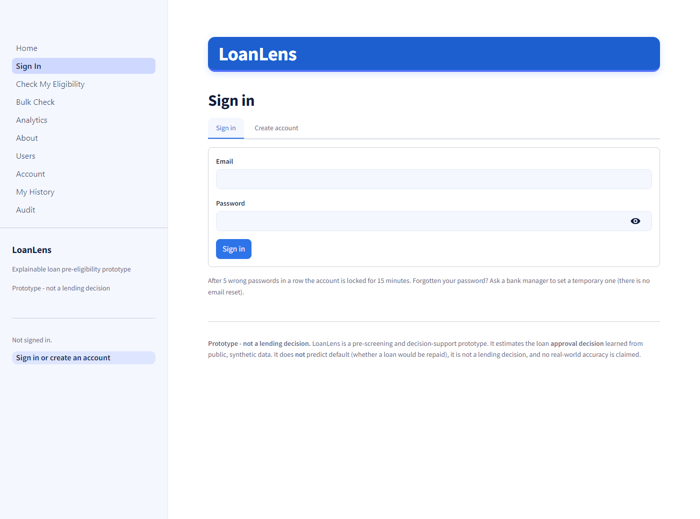
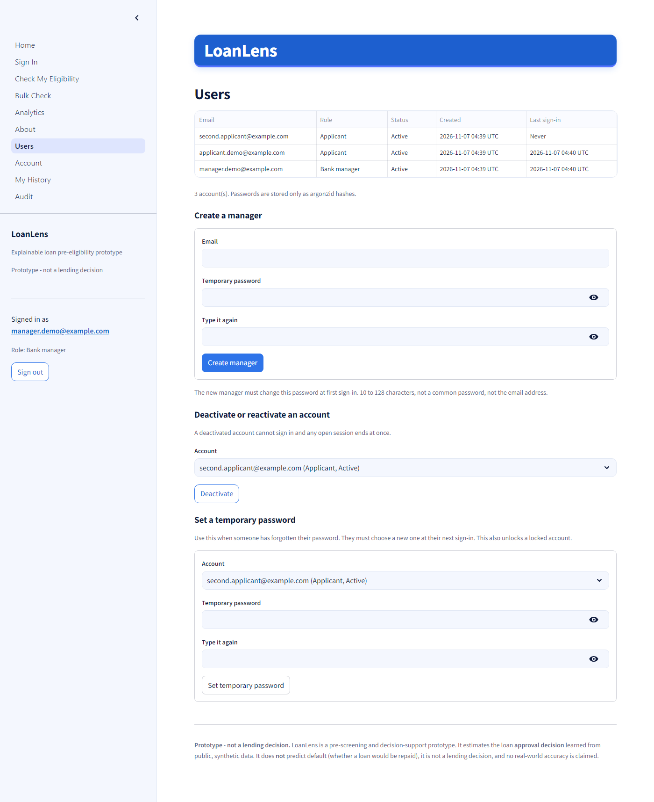
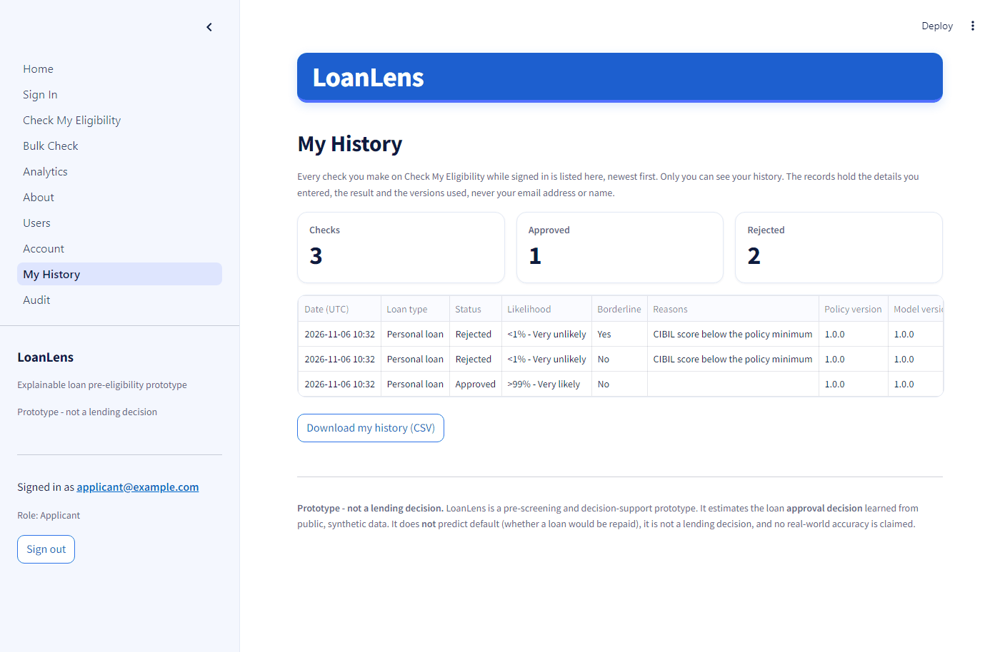
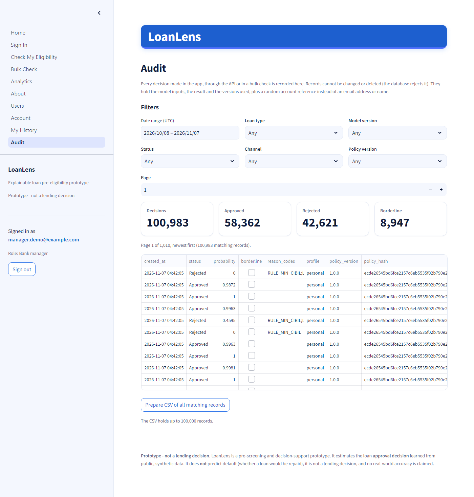
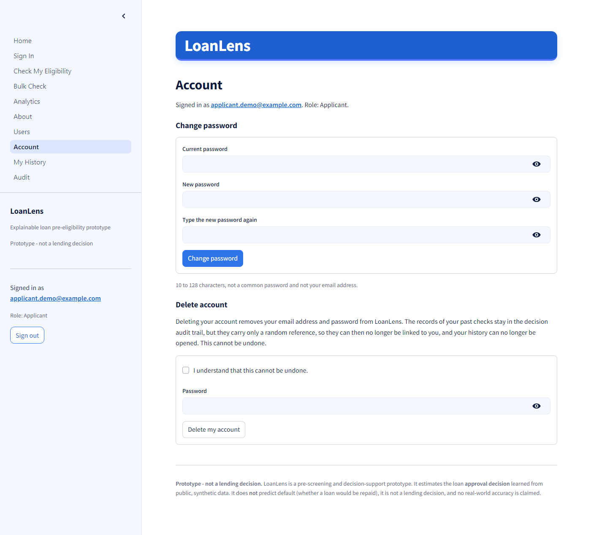
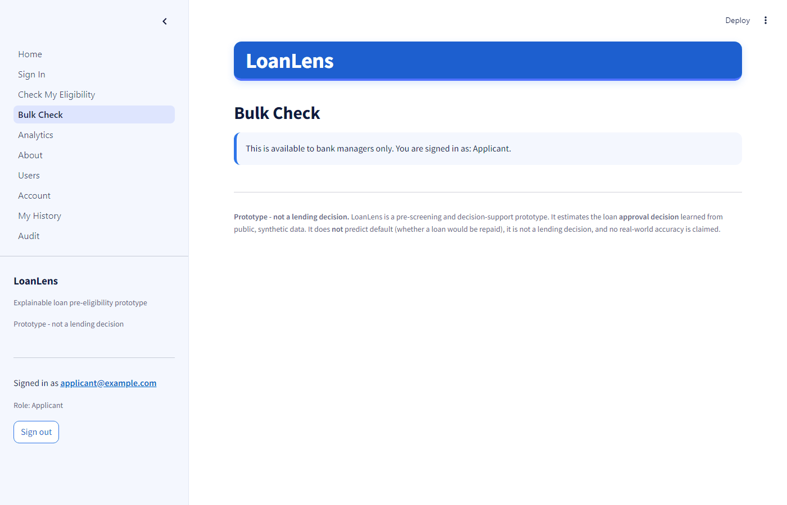

# LoanLens: Explainable Loan Pre-Eligibility & Risk Insights

**LoanLens estimates whether a loan application is likely to be approved or rejected, and explains why in plain language, including what would likely change the result.**

> **Independent proof of concept for learning and demonstration. Not a lending decision. Uses public synthetic data.**


LoanLens is a **pre-screening and decision-support prototype**, an independent proof of concept. It has two signed-in roles: an **applicant** checks their own details in a form, and a **bank manager** uploads a CSV of many applicants and gets a decision, a likelihood and reasons for every row, reviews the audit trail and manages user accounts. A REST API offers the same decisions to other systems, and every decision is recorded in an append-only audit trail.

> **Approval, not default.** LoanLens predicts the loan *approval decision* recorded in a public, **synthetic** dataset. It does **not** predict default (a disbursed loan that later goes unpaid, NPA / 90+ days overdue), because there is no repayment data. It is not a lending decision, no real customer or bank data is used, and no real-world accuracy is claimed. Every policy threshold is a placeholder, illustrative until replaced by a lender's real credit policy.

Author: Anshu Raj (GitHub: Anshu-raj-co)

## Contents

- [Results at a glance](#results-at-a-glance)
- [Screenshots](#screenshots)
- [Documentation](#documentation)
- [Quick start (fresh clone)](#quick-start-fresh-clone)
- [Data](#data)
- [The pages](#the-pages)
- [How a decision is made](#how-a-decision-is-made)
- [Accounts and roles](#accounts-and-roles)
- [Audit trail and history](#audit-trail-and-history)
- [REST API](#rest-api)
- [Batch jobs](#batch-jobs)
- [Performance](#performance)
- [Security notes](#security-notes)
- [Project structure](#project-structure)
- [Development](#development)
- [Limitations](#limitations)
- [What a lender would need to provide to take this further](#what-a-lender-would-need-to-provide-to-take-this-further)
- [Future work](#future-work)

## Results at a glance

| | |
|---|---|
| **Chosen model** | XGBoost with monotone constraints (a higher CIBIL never lowers, a bigger loan never raises the score) and isotonic calibration, on 5 features. Chosen as the simplest model within about 1% of the best; the constraints cost 0.4 ROC-AUC points. |
| **Cross-validation** (stratified 5-fold, seed 42) | ROC-AUC 0.9942, PR-AUC 0.9946, precision 0.9527, recall 0.9759, F1 0.9639, accuracy 0.9546 |
| **Leakage check** | Shuffled labels give ROC-AUC 0.499 (chance). CIBIL alone reaches 0.960; without CIBIL the model drops to 0.584. |
| **Tests** | 746 passing and 2 skipped with a PostgreSQL test database (both skips are PostgreSQL-only checks in their SQLite variant); 735 passing and 13 skipped without one (`pytest`), 98% coverage of `src/loanlens`, `ruff` clean |
| **Batch speed** (measured) | 1,000,000 synthetic rows as a background job in 11.1 min on PostgreSQL and 13.9 min on SQLite with every row audited (8.8 and 10.6 min without auditing), with peak memory between 457 and 527 MB at every file size from 100,000 to 1,000,000 rows. Laptop, 2026-11-06; see [reports/performance.md](reports/performance.md) |
| **Benchmark** | In the primary dataset, **CIBIL dominates** (about 99% approved above 550, about 10% at or below). In `bank_loan_data.csv`, **a previous default dominates** and credit score alone had almost no effect (ROC-AUC 0.50). |

The scores are near-perfect because the synthetic label is close to a simple rule, not because the problem is easy in reality. Details: [reports/model_card.md](reports/model_card.md) and [reports/benchmark.md](reports/benchmark.md).

## Screenshots

All screenshots use the built-in hypothetical example applicants or the fully synthetic test file.

| | |
|---|---|
|  **Home:** purpose, the illustrative-thresholds notice and links to every page. |  **Check My Eligibility:** the 8-field form with hints and Indian-grouped amounts. |
|  **Approved:** green banner, likelihood band and the factors working in the applicant's favour. |  **Rejected:** red banner, the exact rule that failed, and what would likely change the result. |
|  **Rejected + borderline:** CIBIL 540 is just below the minimum, so manual review is recommended. |  **Bulk Check:** 1,000-row synthetic upload with summary cards, the skipped-rows report and coloured status cells (taken before Milestone 4 moved Bulk Check to background jobs; to be retaken in Milestone 5). |
|  **Analytics:** approval patterns in the training data, model drivers and the latest batch. |  **About:** framing, metrics, current policy settings, borderline rules, benchmark and model card. |
|  **Sign in:** two tabs, Sign in and Create account (applicants only), with the password rules and what is stored. |  **Users (managers):** every account with role, status, created and last sign-in; create a manager, deactivate or reactivate, set a temporary password. |
|  **My History:** an applicant's own checks with date, loan type, status, likelihood and reasons, and a CSV download. |  **Audit (managers):** every decision (here 980 batch rows and 3 form checks), filters, counts and CSV export. |
|  **Account:** change password (required after a temporary password) and delete the account with a confirmation step. |  **Access rules:** an applicant who opens Bulk Check sees a plain message instead of the page. |

## Documentation

- [PROJECT_EXPLAINED.md](PROJECT_EXPLAINED.md): the project in plain English, then a technical deep dive.
- [USER_GUIDE.md](USER_GUIDE.md): step-by-step instructions for customers and bank managers, including the CSV columns.
- [reports/model_card.md](reports/model_card.md): data, metrics, calibration, leakage checks, constraints and limitations.
- [reports/benchmark.md](reports/benchmark.md): comparison with the larger `bank_loan_data.csv` dataset.
- [reports/decisions_log.md](reports/decisions_log.md): every assumption and placeholder, and the reasoning behind each decision.

## Quick start (fresh clone)

Requires **Python 3.11**. Windows commands are shown; on macOS/Linux use `python3.11 -m venv .venv` and `source .venv/bin/activate`.

**1. Get the code and put the data in place.** Download the three CSV files listed under [Data](#data) and save them in `data/raw/` with exactly these names:

```
data/raw/loan_approval_dataset.csv   # primary: powers the app (required)
data/raw/bank_loan_data.csv          # benchmark notebook only
data/raw/loan_data.csv               # sanity check only
```

**2. Install and run:**

```bash
py -3.11 -m venv .venv               # create the virtual environment
.venv\Scripts\activate               # activate it
pip install -r requirements.txt      # pinned packages + LoanLens itself
python -m loanlens.cleaning          # build the cleaned data used by the Analytics page and tests
streamlit run app/Home.py            # start the app at http://localhost:8501
```

**3. Create the first bank manager** (applicants create their own accounts on the Sign in page):

```bash
python -m loanlens.auth create-manager --email you@example.com   # asks for the password twice
```

The password is typed at a hidden prompt, never on the command line. For a local run nothing else is needed: without `LOANLENS_JWT_SECRET` the app uses a temporary signing key and shows a warning (everyone is signed out when it restarts). Set `LOANLENS_JWT_SECRET` (at least 32 random characters) before sharing the app; see [Accounts and roles](#accounts-and-roles).

The registered model (version 1.0.0, about 0.4 MB) and `models/registry.json` are committed, so no training is needed to use the app. `python -m loanlens.model` trains a **new** version (see [Model registry](#model-registry)); it also builds the cleaned data if it is missing. If no model is registered, every page shows a friendly message telling you to run that command; nothing crashes.

The earlier fresh-clone verification in `reports/progress.md` predates the model registry and policy profiles (Milestone 1); it has not been repeated since.

## Data

The CSV files are third-party Kaggle datasets. They are **not committed** to this repository (`data/raw/` and `data/processed/` are gitignored), so the licence terms of each source apply. Download them from:

| File in `data/raw/` | Source | Role |
|---|---|---|
| `loan_approval_dataset.csv` | Kaggle, "Loan-Approval-Prediction-Dataset" (owner `architsharma01`): https://www.kaggle.com/datasets/architsharma01/loan-approval-prediction-dataset (licence shown: MIT) | **Primary.** 4,269 rows, INR, CIBIL 300-900. Powers the app. |
| `bank_loan_data.csv` | Kaggle, "bank_loan_data" (owner `udaymalviya`): https://www.kaggle.com/datasets/udaymalviya/bank-loan-data (licence shown: MIT) | **Benchmark only** (`notebooks/04_benchmark_bank_loan_data.ipynb`). Never merged with the primary data. Note: this page describes `loan_status` as 1 = repaid, 0 = defaulted, which is why `reports/benchmark.md` treats its label with caution. |
| `loan_data.csv` | A 381-row copy of the widely shared "Loan Prediction" practice dataset (columns `Loan_ID ... Loan_Status`). **Source not verified.** | Sanity check only, otherwise unused. |

Licences were read from Kaggle's dataset metadata; please check each page yourself before redistributing the files. The 1,000-row test file `tests/fixtures/batch_1000.csv` is **fully synthetic** (generated by `scripts/make_batch_fixture.py`); it contains no rows from any dataset.

## The pages

| Page | What it does |
|---|---|
| **Home** (public) | Purpose, the placeholder-thresholds notice, links to every page and a short "how a result is decided" summary. |
| **Sign in** (public) | Two tabs: **Sign in**, and **Create account** for applicants. Manager accounts cannot be created here. |
| **Check My Eligibility** (any signed-in user) | A **Loan type** selector (personal, home, vehicle) and an 8-field form with ranges, hints and Indian-grouped amounts (e.g. "= Rs 1,50,00,000"). Returns a green "Approved" or red "Rejected" banner with the likelihood (e.g. "96% - Very likely", labelled "model score on synthetic data - indicative only"), an amber "Borderline - manual review recommended" pill when relevant, reason cards, "what would likely change this", positive factors, warnings and the policy checks (each marked "Passed" or "Failed"). Each check is saved to the account's **history** and the **audit trail** (model inputs, result and versions; never an email or name). |
| **Bulk Check** (bank managers) | Download the CSV template, upload a **CSV or Parquet** file of up to **1,000,000 rows and 200 MB**, pick the loan type and submit it as a **background job**. A progress bar follows the job (polled every two seconds, with a cancel button); the job list shows every job's status, counts and times. For a completed job: summary cards (total, approved, rejected, borderline, skipped, approval rate), top rejection reasons, downloads of the results (CSV and Parquet) and of the skipped rows (with spreadsheet row numbers and every problem), and a preview of the first 1,000 results. An optional `product` column picks each row's loan type (blank means the chosen one; an unknown value is a row problem). Every scored row is written to the **audit trail** (model inputs, result, versions and the manager's random reference; no names or applicant IDs), and an **anonymised summary** of the batch is saved for Analytics. See [Batch jobs](#batch-jobs). |
| **Analytics** (bank managers) | Approval rate by CIBIL band, loan term and loan size in the training data; what drives the model (mean absolute SHAP share); and the latest batch summary. |
| **About** (public) | The framing, data source, the active model version and its metrics, every registered model version, every loan type's policy values side by side with the enforce settings, how the borderline flag works, the benchmark summary and the full model card. |
| **Users** (bank managers) | Every account (email, role, status, created, last sign-in). Create another manager, deactivate or reactivate an account, set a temporary password. |
| **My History** (any signed-in user) | Your own past checks (date, loan type, status, likelihood band, reasons) with a CSV download. Nobody else's records are ever shown. |
| **Audit** (bank managers) | The whole decision audit trail with filters (date range, status, loan type, channel, model version, policy version), counts and CSV export. |
| **Account** (any signed-in user) | Change your password (required after a temporary password) and delete your account, with a confirmation step. |

## How a decision is made

Single source of truth: `src/loanlens/decision.py`. Customer mode and Bulk Check use the same vectorised core, so they always agree. For every application, in order:

1. **Validate** the input (Pydantic). Missing or impossible values return a clear message and no decision.
2. **Policy rules** from the selected loan type's profile in `config/policies/` (personal by default). Each rule has a `value` and an `enforce` flag. For the default personal profile:
   - *Enforced* rules (minimum CIBIL 550, loan at most 4.0x annual income, loan at most 1.5x total assets, term 2 to 20 years): a failure means **Rejected**, whatever the model says, with that rule as the reason.
   - *Advisory* rules (EMI at most 50% of monthly income, using an **assumed 10% interest rate** because the data has no rate): a failure only adds a warning.
3. **Model**: a calibrated XGBoost probability `p` (features: CIBIL, loan term, loan-to-income, income, total assets; monotone so a higher CIBIL never lowers, and a bigger loan never raises, the score). `p >= 0.5` means Approved.
4. **Borderline flag** ("manual review recommended"): when `p` is between 40% and 60% with no enforced rule failed, or when the CIBIL score is within 25 points of the minimum and no *other* enforced rule failed. The status stays Approved or Rejected.
5. **Reasons**: rule failures first, then the strongest negative model drivers (SHAP) in plain English with "your value" vs a benchmark; at most 5. Every rejection has at least one reason. Approvals get positive factors.
6. **What would change**: the smallest CIBIL increase or loan reduction that would likely flip a rejection ("would likely", never "guaranteed"). It never suggests a shorter term or a bigger loan.

The displayed score never reads 0% or 100% (">99%" / "<1%") and carries a verbal band (Very likely, Likely, Borderline, Unlikely, Very unlikely).

Every result records which settings produced it: `profile`, `policy_version`, `policy_hash` (SHA-256 of the profile's validated settings) and `model_version`.

## Loan types (policy profiles)

Each loan type has one file in `config/policies/` with `profile`, `version` (semantic version), `description` and the settings. **A loan type changes the policy rules and assumptions, not the trained model**: every loan type is scored by the same model, which learned from one synthetic dataset with no loan-type information. All values are illustrative placeholders.

| Setting | Personal (default) | Home | Vehicle |
|---|---|---|---|
| Loan term | 2 to 20 years | 5 to 30 years | 1 to 7 years |
| Maximum loan / annual income | 4.0x | 6.0x | 1.5x |
| Maximum loan / total assets | 1.5x | 2.0x | 1.0x |
| Assumed interest rate (for EMI) | 10% | 8.5% | 11% |
| Minimum CIBIL, EMI cap, model threshold, borderline band | same | same | same |

`personal.yaml` reproduces the original `config/policy.yaml` exactly, and the built-in example decisions under it are unchanged (checked by `tests/test_profiles.py`). The model only saw loan terms of 2 to 20 years and loan-to-income of 1.5x to 4.0x, so a home loan of, say, 25 years or 5x income passes the home rules but gets an out-of-range warning and is scored by a model that never saw such cases. The batch, storage and cleaning sections are app-wide and are read from the personal profile.

## Model registry

`models/registry.json` records every trained model version: version, creation time, training-data hash, feature list, cross-validation metrics, artifact file name, artifact SHA-256 and status (`active` or `archived`).

```bash
python -m loanlens.model                    # train, save models/loanlens_model_<version>.joblib, register, activate
python -m loanlens.model --version 2.0.0    # choose the version number (default: next minor version)
python -m loanlens.model --no-activate      # register without switching the active model
python -m loanlens.model --list             # show every registered version
python -m loanlens.model --activate 1.0.0   # switch the active version (older artifacts are kept)
```

The app loads the active version, or the one named by `LOANLENS_MODEL_VERSION`, and first checks the file's SHA-256 against the registry; a mismatch stops loading with a plain message. The original single artifact was registered as version 1.0.0 with its bytes unchanged, so its predictions are identical. The registry and the active artifact are committed (`.gitignore` lists them); archived artifacts stay local.

## Database

Anonymised batch summaries are stored through SQLAlchemy 2. The database comes from the `DATABASE_URL` environment variable; without it LoanLens uses the local SQLite file `sqlite:///data/loanlens.sqlite`. PostgreSQL works through psycopg (`postgresql://...`). The schema is managed by Alembic (`src/loanlens/db/migrations/`); the app applies migrations itself, or run `alembic upgrade head` from the project root. A database that cannot be reached gives a plain message, never a stack trace. Because every decision must be recorded in the audit trail, no result is shown until it can be recorded; a batch summary that fails to save does not block the results. `.env.example` lists the environment variable names (no values).

## Accounts and roles

| Role | How the account is created | What it can use |
|---|---|---|
| **Applicant** | Self sign-up on the **Sign in** page (email and password) | Check My Eligibility, Account |
| **Bank manager** | `python -m loanlens.auth create-manager --email <email>`, the one-time bootstrap settings, or by another manager on the **Users** page | Everything an applicant can, plus Bulk Check, Analytics and Users |

Home, Sign in and About are public. Anyone else who opens a page they cannot use sees a plain message and a link to sign in. Roles are checked in the service layer (`src/loanlens/auth/service.py`), not only in the pages: every account function takes the signed-in user and checks the role, and manager actions re-read the account from the database first.

- **Passwords** are hashed with argon2id (argon2-cffi defaults). They must be 10 to 128 characters, not on the built-in list of common passwords and not the same as the email address. Emails are stored lower-case and checked for a valid format.
- **Signing in:** every failure shows the same message, "Incorrect email or password". After 5 wrong passwords in a row the account is locked for 15 minutes; deactivated accounts cannot sign in.
- **Sessions** are signed tokens (JWT, HS256) holding the account number, role and expiry (60 minutes). The token lives only in the Streamlit session and is checked again on every page load, so an expired session, a deactivated account or a changed role sends the user back to Sign in. Tokens also carry the account's token version: changing your password, a manager setting a temporary password, and deactivating or reactivating the account all raise it, so every older token (including a copied one) stops working, while the session that changed the password receives a fresh token.
- **No public manager sign-up and no default credentials.** The first manager comes from the command line or from `LOANLENS_BOOTSTRAP_MANAGER_EMAIL` and `LOANLENS_BOOTSTRAP_MANAGER_PASSWORD`, used only while no manager exists. A bootstrapped manager must change the password at first sign-in, and the app logs a warning to remove the two settings.
- **Manager actions:** create managers (who must change their temporary password), deactivate or reactivate any other account, and set a temporary password, which is how a forgotten password is reset. A manager cannot change their own status, and the last active manager cannot delete their own account.
- **Own account:** anyone can change their password (the current one is required). Deleting an account removes the user row, so records kept under its random audit reference can no longer be linked to a person, and earlier sign-in events lose their link to it.

**Personal data stored per account:** email address, password hash, role, status flags, the time the account was created and the last sign-in, the failed-attempt counter and lock time, and a random audit reference. The `auth_events` table records sign-ins and account changes with a short reason code (for example `wrong_password`); it never holds a password, a token or an email address. Decisions are recorded in the audit trail described below.

**Settings** (environment variables; names in `.env.example`):

| Variable | Meaning |
|---|---|
| `LOANLENS_JWT_SECRET` | Signs session tokens, at least 32 characters. Missing in local development: a temporary key is used and a warning is shown. Missing with `LOANLENS_ENV=production` or `LOANLENS_HOSTED=1`: the app refuses to start. |
| `LOANLENS_SESSION_MINUTES`, `LOANLENS_LOCKOUT_ATTEMPTS`, `LOANLENS_LOCKOUT_MINUTES` | Session length (default 60), failed attempts before a lock (5) and lock length (15). |
| `LOANLENS_BOOTSTRAP_MANAGER_EMAIL`, `LOANLENS_BOOTSTRAP_MANAGER_PASSWORD` | One-time creation of the first manager. Remove them afterwards. |

**Honest limitations:** email addresses are not verified; there is no self-service password reset (a manager sets a temporary password); the Streamlit session ends when the page is refreshed or closed, so the user signs in again.

## Audit trail and history

Every decision is written to the **append-only** table `decision_audit` before it is shown: decisions from the Check My Eligibility page (channel `ui`), from the REST API (`api`) and from every row of a Bulk Check upload (`batch`, inserted in chunks of 1,000). If the record cannot be written, the result is not shown.

Each record holds: a random id, the time (UTC), `user_ref` (the signed-in account's random audit reference, never an email or name), the role, the channel, a batch id for batches, the request id (the API's `X-Request-ID`), the loan type, policy version and hash, model version, **only the eight model input fields**, the status, probability, borderline flag and reason codes.

- **Append-only:** there is no code that updates or deletes a record, and database triggers reject every `UPDATE` and `DELETE` on the table (on SQLite and PostgreSQL; PostgreSQL also rejects `TRUNCATE`). Tests prove the triggers work on SQLite and on PostgreSQL (run against PostgreSQL 16.15 on 2026-11-06); see [Development](#development).
- **My History** shows applicants their own records only (date, loan type, status, likelihood, reasons), with a CSV download.
- **Audit** (managers) filters by date range, status, loan type, channel, model version and policy version, shows counts and exports CSV.
- **Account deletion:** the user row is removed, but the audit records stay. They carry only the random reference, so they can no longer be linked to the person, and nobody can open that history again.

## REST API

A FastAPI service under `/v1` uses the **same protected service layer and Pydantic schemas** as the Streamlit app, so a decision is identical whichever way it is requested (tests compare every built-in example under every loan type). The Streamlit pages call the service layer directly, in the same process, rather than over HTTP: this keeps the app simple to run and host, while the API serves other systems.

```bash
uvicorn loanlens.api.app:app --port 8000      # or: python -m loanlens.api (127.0.0.1:8000)
```

Interactive OpenAPI docs: http://127.0.0.1:8000/docs .

| Endpoint | Who | What |
|---|---|---|
| `POST /v1/auth/register` | public | Create an applicant account; returns a bearer token |
| `POST /v1/auth/login` | public | Sign in; returns a bearer token (60 minutes) |
| `GET /v1/auth/me` | signed in | The account (email, role, must-change-password flag) |
| `POST /v1/score` | signed in | Score one applicant (the 8 fields plus optional `product`) |
| `POST /v1/score/batch` | manager | Score a JSON list of up to `LOANLENS_API_MAX_BATCH` applicants (default 1,000) |
| `GET /v1/policies`, `GET /v1/policies/{profile}` | public | Loan types and their (placeholder) settings |
| `GET /v1/model` | public | The active model version and its metrics |
| `GET /v1/audit` | manager | The audit trail, paginated (`page`, `page_size` up to 500) with the same filters as the Audit page |
| `POST /v1/batches` | manager | Upload a CSV or Parquet file (multipart field `file`, optional `product`, `include_positive`) as a background job; 202 with the job |
| `GET /v1/batches`, `GET /v1/batches/{id}` | manager | Recent jobs of all managers; one job with progress, counts and download links |
| `GET /v1/batches/{id}/result` | manager | Results of a completed job as Parquet, or CSV with `?format=csv` (409 before it completes) |
| `GET /v1/batches/{id}/errors` | manager | The skipped rows (row number, applicant ID, problem) as CSV |
| `POST /v1/batches/{id}/cancel` | manager | Cancel a queued job, or stop a running one after its current chunk |
| `GET /health`, `GET /ready` | public | Liveness; readiness (database reachable and model loaded, else 503) |

Examples (bash; the email and password are examples):

```bash
API=http://127.0.0.1:8000

# Register an applicant (returns {"access_token": ..., "token_type": "bearer", ...})
curl -s -X POST $API/v1/auth/register -H "Content-Type: application/json" \
     -d '{"email": "priya@example.com", "password": "plum river lamp 42"}'

# Sign in and keep the token
TOKEN=$(curl -s -X POST $API/v1/auth/login -H "Content-Type: application/json" \
     -d '{"email": "priya@example.com", "password": "plum river lamp 42"}' \
     | python -c "import json,sys; print(json.load(sys.stdin)['access_token'])")

# Score one applicant
curl -s -X POST $API/v1/score -H "Authorization: Bearer $TOKEN" -H "Content-Type: application/json" \
     -d '{"cibil_score": 480, "income_annum": 5000000, "loan_amount": 12000000, "loan_term": 10,
          "residential_assets_value": 6000000, "commercial_assets_value": 2000000,
          "luxury_assets_value": 4000000, "bank_asset_value": 1500000, "product": "personal"}'
# -> "status": "Rejected", "likelihood": "<1% - Very unlikely", reasons such as
#    "CIBIL score 480 is below the minimum 550.", what_would_change, warnings, profile,
#    policy_version, model_version and request_id (also in the X-Request-ID header)

# Read the audit trail (manager token; an applicant gets 403 "forbidden")
curl -s "$API/v1/audit?page=1&page_size=50&status=Rejected&channel=api" \
     -H "Authorization: Bearer $MANAGER_TOKEN"
```

The responses above were produced by a local run on 2026-11-06.

- **Errors** always look like `{"error": {"code": ..., "message": ..., "request_id": ...}}`, with `details` for validation errors (field names and messages, never the submitted values). 401 for a missing, expired or invalidated token, 403 for a role that is not allowed or an account that must change its password first, 422 for invalid input, 429 when rate-limited, 503 when the database is unavailable.
- **Request IDs:** a safe incoming `X-Request-ID` is kept, otherwise one is generated; it is returned in the header and stored in the audit record.
- **Logs** are one JSON object per request: time, request id, method, route, status, duration and role. No email, password, token, input value or client address is logged, and uvicorn's own access log is switched off by `python -m loanlens.api`.
- **Rate limits** on `/v1/auth/login` and `/v1/auth/register`: at most 10 attempts per client address and 5 per account (email) in any 60 seconds (`LOANLENS_API_AUTH_LIMIT_PER_CLIENT`, `LOANLENS_API_AUTH_LIMIT_PER_ACCOUNT`, `LOANLENS_API_AUTH_WINDOW_SECONDS`), answered with 429 and `Retry-After`. One client cannot try many accounts or many passwords quickly, and one account cannot be attacked quickly from many addresses. The counters are **in memory**: they reset when the server restarts and are not shared between server processes. The client address is the direct connection's address; behind a proxy every request would share the proxy's address.
- **CORS** is off unless `LOANLENS_API_CORS_ORIGINS` lists allowed origins (comma-separated).

## Batch jobs

Bulk Check uploads and `POST /v1/batches` create a row in `batch_jobs` (Alembic `0004_batch_jobs`) and are processed in the background:

- **Chunked and memory-safe:** the file (CSV or Parquet) is read 20,000 rows at a time (`LOANLENS_JOB_CHUNK_SIZE`). Each chunk is validated, scored with the same decision core as every other path, written to the audit trail in bulk inserts (1,000 records each; `LOANLENS_BATCH_AUDIT_CHUNK`), and appended to a Parquet and a CSV results file and an errors CSV with the original row numbers. Summary counts are kept as running totals. Neither the file nor the results are ever held in memory as a whole. Decisions are identical to the previous in-memory path (tested on the 1,000-row fixture at several chunk sizes).
- **Workers:** `python -m loanlens.worker` polls for queued jobs and claims one atomically (`SELECT ... FOR UPDATE SKIP LOCKED` on PostgreSQL; a single conditional `UPDATE` on SQLite). When no external worker is running, the Streamlit app and the API start an **embedded background-thread worker** (`LOANLENS_EMBEDDED_WORKER`, on by default). Running jobs without a heartbeat for `LOANLENS_JOB_STALE_SECONDS` (300) are marked failed when a worker starts and every minute after, so a restart of the app or of a hosted platform interrupts a job, which is then failed and can be submitted again. `python -m loanlens.worker --once` processes the queue and exits.
- **No session token in the worker:** the manager is verified at submission and their random `audit_ref` is stored on the job; the worker uses it for the audit records (role `manager`) and checks before running that it still belongs to an active manager. Any manager may view, download and cancel every job.
- **Audit:** each job has its own audit `batch_id` (shown on the job). If a job fails or is cancelled part-way, the records already written remain, because the trail is append-only; the job's note gives the count and the batch id, and uploading again creates a new batch id. `LOANLENS_BATCH_AUDIT=off` exists only for benchmarks and is refused in production or hosted mode.
- **Files:** uploads and results are stored in a private directory (`LOANLENS_JOBS_DIR`, default `data/jobs/`, gitignored) under random names, never the client's file name; only names of that form are ever opened, and download paths come from the job record, never from the request. The upload is deleted when the job ends. Results and error files can contain applicant IDs, so `python -m loanlens.worker --cleanup` (also run whenever a worker starts) deletes them after `LOANLENS_JOB_RETENTION_DAYS` (7) and marks the jobs expired.
- **Limits:** 1,000,000 rows per job (`LOANLENS_JOB_MAX_ROWS`), 200 MB per upload (`server.maxUploadSize` in `.streamlit/config.toml`; `LOANLENS_JOB_MAX_UPLOAD_MB` for the API).

```bash
TOKEN=...   # a manager's access_token from /v1/auth/login
curl -s -X POST "$API/v1/batches" -H "Authorization: Bearer $TOKEN" \
     -F "file=@applicants.csv" -F "product=personal"           # -> {"id": ..., "status": "queued", ...}
curl -s "$API/v1/batches/<id>" -H "Authorization: Bearer $TOKEN"  # progress, counts, result_url
curl -s -o results.parquet "$API/v1/batches/<id>/result" -H "Authorization: Bearer $TOKEN"
curl -s -o results.csv "$API/v1/batches/<id>/result?format=csv" -H "Authorization: Bearer $TOKEN"
curl -s -o skipped.csv "$API/v1/batches/<id>/errors" -H "Authorization: Bearer $TOKEN"
```

## Performance

Measured on one laptop (Intel Core i7-11800H, 16 GB RAM, Windows 11) on 2026-11-06. Full tables, method and caveats: [reports/performance.md](reports/performance.md) and [reports/load_test.md](reports/load_test.md). Nothing is extrapolated.

**Batch jobs** (synthetic files, the real job path end to end, one worker):

| Rows | SQLite, audit on | SQLite, audit off | PostgreSQL, audit on | PostgreSQL, audit off |
|---:|---:|---:|---:|---:|
| 100,000 | 79.3 s (1,262 rows/s) | 70.3 s | 70.7 s (1,414 rows/s) | 55.7 s |
| 500,000 | 402.0 s (1,244 rows/s) | 264.4 s | 344.5 s (1,451 rows/s) | 267.8 s |
| 1,000,000 | 833.5 s (1,200 rows/s) | 633.3 s | 663.7 s (1,507 rows/s) | 525.9 s |

Peak memory stayed between 457 and 527 MB in every run (growth of 104 to 168 MB above the loaded model), whatever the file size. About 60% of scoring time is explanation work ("what would change" and SHAP). One PostgreSQL run was invalidated by the laptop going to sleep and was repeated (details in the report).

**REST API** (`POST /v1/score`, Locust on the same laptop, 60 s per level, every request writes an audit record):

| Set-up | 10 users | 50 users | 100 users |
|---|---|---|---|
| 1 worker, PostgreSQL | 9.3 req/s, p50 60 ms | 22.7 req/s, p50 1.1 s | 21.3 req/s, p50 3.4 s |
| 4 workers, PostgreSQL | 9.6 req/s, p50 53 ms | 44.9 req/s, p50 59 ms | 81.0 req/s, p50 93 ms, p95 380 ms |
| 4 workers, SQLite | 8.5 req/s, p50 51 ms | 39.9 req/s, p50 150 ms | 51.5 req/s, p95 3.7 s, 1.1% failed (database lock) |

One worker process is CPU-bound at about 18 to 23 scores a second (about 56 ms of server time each); more worker processes scale it, and with several processes PostgreSQL should be used instead of SQLite. The sign-in limits were raised for the load test only.

## Security notes

- There are **no default or demo passwords**. Accounts use argon2id password hashes, signed and expiring session tokens, a lockout after repeated failures and generic sign-in errors (see [Accounts and roles](#accounts-and-roles)).
- Passwords, tokens and email addresses are never logged or written to the sign-in event table. Inputs are validated with Pydantic.
- Set `LOANLENS_JWT_SECRET` before sharing the app; with `LOANLENS_ENV=production` or `LOANLENS_HOSTED=1` the app will not start without it.
- Decisions are stored in the append-only audit trail with the model input fields only and a random account reference (no email or name). Every function that scores, reads analytics or touches the audit trail checks the signed-in user's role itself (`src/loanlens/services.py`). Bulk Check also saves anonymised batch summaries (counts, approval rate, top reasons) in the configured database (a local SQLite file by default); applicant IDs are stored only if `storage.store_applicant_ids` is switched on in `config/policies/personal.yaml` (it is off). Database access uses the SQLAlchemy ORM or parameterised statements only.
- Batch uploads and their result files (which can contain applicant IDs) are kept in a private, gitignored directory under random names, never served from a path in a request, and deleted after the retention period (7 days by default; uploads as soon as the job ends). See [Batch jobs](#batch-jobs).
- The API rate-limits sign-in and registration per client address and per account, keeps CORS off by default and writes JSON logs without personal data.
- The database URL comes from the environment (`DATABASE_URL`) and is never written to the repository or shown in error messages.
- Datasets, archived model files, the SQLite database, `.env` and `.streamlit/secrets.toml` are gitignored. No password or secret exists in the code or the repository; the tests generate their own at run time.

## Project structure

```
CLAUDE.md                 project brief and working agreement
README.md, USER_GUIDE.md, PROJECT_EXPLAINED.md
requirements.txt          pinned packages (+ `-e .` for the loanlens package)
requirements-dev.txt      optional extras (Playwright for screenshots, Locust for the load test)
pyproject.toml            package, ruff and pytest settings
config/policies/          one profile per loan type: personal (default), home, vehicle (all PLACEHOLDERS)
alembic.ini               Alembic settings (database from DATABASE_URL)
.env.example              environment variable names (no values)
.streamlit/config.toml    light theme; stack traces hidden from users
data/raw/                 the three Kaggle CSVs (not committed)
data/processed/           cleaned primary dataset (built by `python -m loanlens.model`)
models/                   registry.json and the active artifact (committed); archived versions (local)
notebooks/                01_audit, 02_eda, 03_modelling, 04_benchmark_bank_loan_data
src/loanlens/
  schema.py               Pydantic input/output models, friendly validation messages
  cleaning.py             cleaning of the primary dataset
  features.py             EMI, ratios, total assets, CIBIL bands
  rules.py                policy rules (enforced vs advisory)
  model.py                train, cross-validate, calibrate, save, load; CLI (--list, --activate)
  registry.py             model registry: versions, hashes, active version, integrity check
  explain.py              SHAP reasons, positive factors, what-would-change search
  decision.py             orchestrates everything (single source of truth)
  batch.py                CSV/Parquet reading (chunked), validation, scoring
  pipeline.py             chunked, memory-safe batch pipeline (audit, result and error files)
  jobs.py                 batch_jobs table, settings, private files, atomic claims, retention
  worker.py               batch job worker (python -m loanlens.worker, embedded thread)
  synthetic.py            synthetic applicants for benchmarks and large-file tests
  storage.py              anonymised batch summaries (via the db layer)
  services.py             the protected service layer the pages and the API call (role checks)
  audit.py                append-only decision audit trail (records, filters, counts)
  api/                    FastAPI app (/v1), schemas, settings, rate limiter
  db/                     SQLAlchemy engine and sessions, tables, Alembic migrations
  presentation.py         display text and views used by the pages
  formatting.py           Indian digit grouping, score display
  theme.py                every colour, the app CSS and the Plotly template
  charts.py               Plotly charts (Analytics page and notebooks)
  auth/                   accounts, argon2id passwords, JWT sessions, roles, CLI (create-manager)
  config.py, examples.py  policy profiles, content hash; six hypothetical example applicants
app/                      Streamlit pages: Home, Sign in, Check My Eligibility, Bulk Check,
                          Analytics, About, Users, Account, My History, Audit
                          (layout only; logic is in src/loanlens)
reports/                  model card, benchmark, performance, load test, decisions log, progress,
                          examples, screenshots
scripts/                  example_decisions.py, make_batch_fixture.py, benchmark_batch.py
tests/                    pytest suite (unit tests and headless page tests); fixtures/ is synthetic;
                          load/locustfile.py (load test, dev only)
```

## Development

```bash
python -m loanlens.model               # train and register a new model version
python -m loanlens.model --list        # registered versions
alembic upgrade head                   # apply database migrations (DATABASE_URL or local SQLite)
python -m loanlens.auth create-manager --email <email>   # create a manager (password prompt)
uvicorn loanlens.api.app:app           # serve the REST API (docs at /docs)
python -m loanlens.worker              # batch job worker (--once: drain the queue; --cleanup: retention)
python scripts/benchmark_batch.py      # measure 100k/500k/1M-row jobs (reports/performance.md)
python -m loanlens.rules               # write reports/rules_vs_labels.md
python scripts/example_decisions.py    # write reports/example_decisions.md
python scripts/make_batch_fixture.py   # regenerate the synthetic tests/fixtures/batch_1000.csv
ruff check .
pytest                                 # 735 passed, 13 skipped (746 passed, 2 skipped with PostgreSQL)
pytest --cov=loanlens                  # coverage of src/loanlens (98%)
```

Tests that need the dataset or model skip themselves if `data/raw/` is empty. The suite includes a memory test that streams a generated 200,000-row file (about two minutes). The PostgreSQL tests (database layer, audit triggers and job claiming with `SKIP LOCKED`) run only when `LOANLENS_TEST_POSTGRES_URL` points at a disposable test database (its tables are dropped); otherwise they are skipped. On 2026-11-06 all 11 of them ran and passed against a disposable PostgreSQL 16.15 database (a local `postgres:16` Docker container on this Windows machine): the database layer, the audit triggers including `TRUNCATE`, the check that migrations leave logging alone, and job claiming with two or more workers (`SKIP LOCKED`). LoanLens itself has not yet been run inside Docker (Milestone 5).

## Limitations

- **Synthetic data.** The patterns reflect how the Kaggle dataset was generated, not any real lender's policy or real borrowers. Scores are near-perfect for that reason, not because the problem is easy in reality.
- **CIBIL dominates.** About 99% of applicants above CIBIL 550 are approved and about 10% at or below; CIBIL has 57% of the model's influence. The second feature, loan term, matters only because of a synthetic quirk (short-term, low-CIBIL approvals), and "what would change" never suggests changing the term.
- **Approval, not default.** Nothing here measures repayment risk.
- **Placeholder thresholds.** Every value in `config/policies/` (minimum CIBIL, loan-to-income, loan-to-assets, term limits, EMI cap, borderline band and margin, likelihood bands, which rules are enforced) is illustrative until replaced by a lender's real credit policy.
- **Assumed interest rate.** The data has no rate or existing EMIs, so EMI uses an assumed 10% a year and the EMI-to-income rule is advisory only.
- **Narrow training ranges.** Loan-to-income only spans 1.5 to 4.0 in the data; inputs outside the training ranges get a warning.
- **One model for every loan type.** Loan types change the rules and assumptions only; the model has no loan-type information.
- **In-memory rate limits.** The API's sign-in limits reset when it restarts and are not shared between processes.
- **Embedded batch worker.** Without a separate worker process, jobs run in a thread inside the app; restarting the app (or a hosted platform putting it to sleep) interrupts a running job, which is marked failed and must be submitted again.
- **Simple accounts.** Email addresses are not verified, there is no self-service password reset (a manager sets a temporary password), and the Streamlit session ends when the page is refreshed.

## What a lender would need to provide to take this further

- **Its real credit-policy thresholds** and which rules are hard rules, replacing every placeholder in `config/policies/`, with one profile per product (the full list is at the top of [reports/decisions_log.md](reports/decisions_log.md)).
- **Repayment outcome data** for disbursed loans, to build a separate default-risk model with its own target.
- **Integration with its systems** (loan origination, credit bureau pulls, product interest rates and existing EMIs).
- **Its own staff sign-in** (for example single sign-on), email verification and a password-reset process, in place of the prototype's simple accounts.
- **A compliance and fairness review** of the data, features, reasons and wording before any use with real applicants.

## Future work

- **Real repayment data**, so that default risk could be studied.
- **Real policy thresholds** (and enforce settings) from a lender, replacing every placeholder.
- Email verification and self-service password reset; shared rate limiting if the API runs as several processes.
- **A default-risk model**, as a separate model with its own target, once repayment outcomes exist.
- **Power BI dashboard** fed by exported, dashboard-ready CSVs.
- Collecting the fields the benchmark shows are missing: previous defaults, employment experience, home ownership, loan purpose, offered interest rate and existing EMIs (`reports/benchmark.md`).
