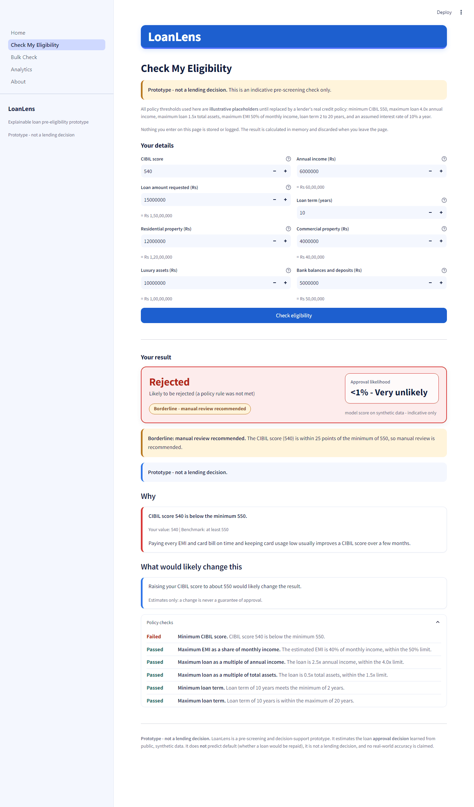
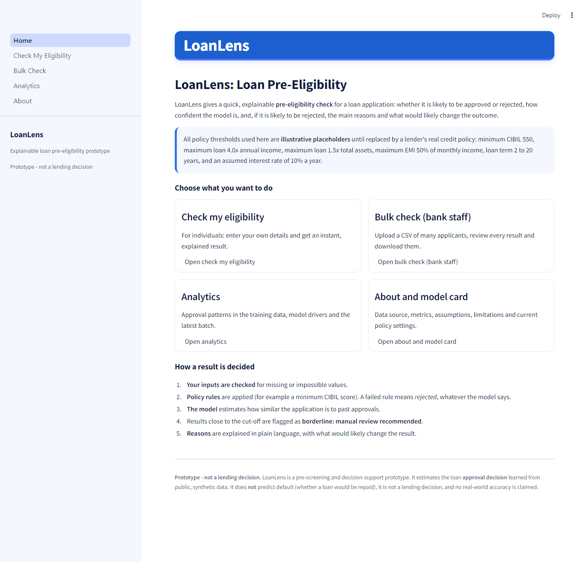
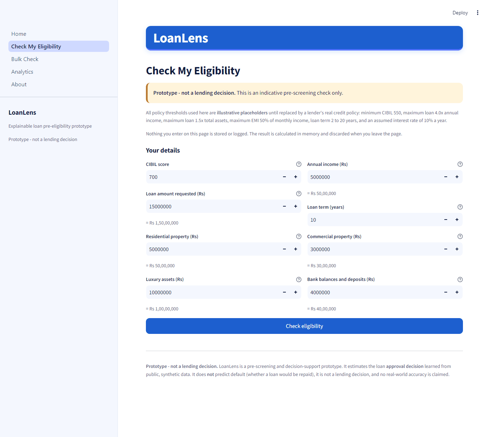
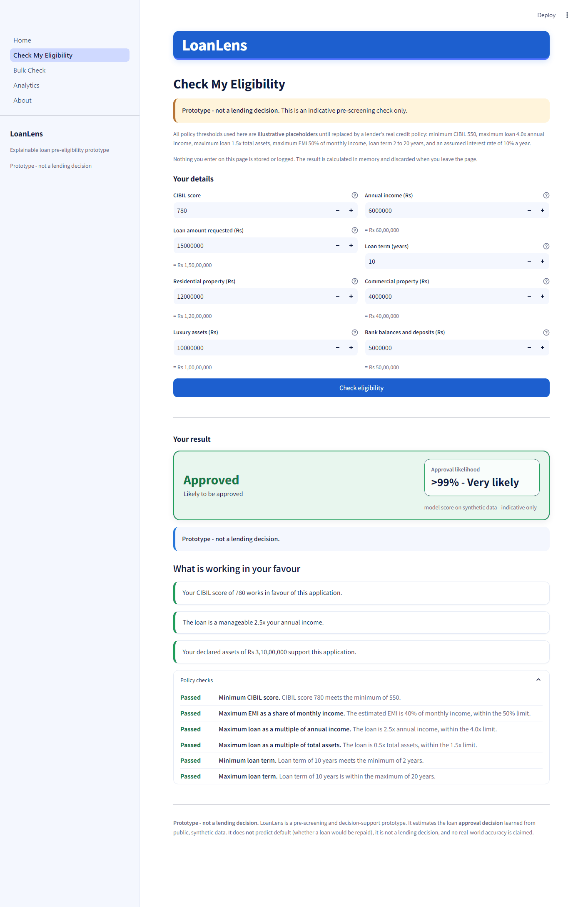
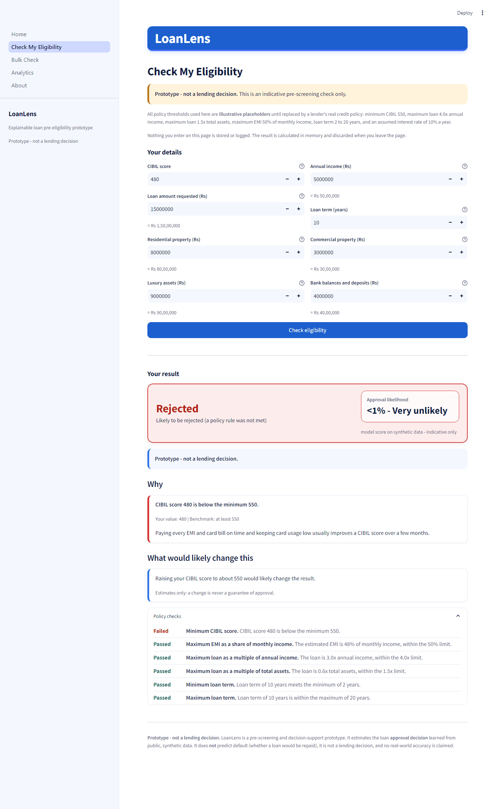
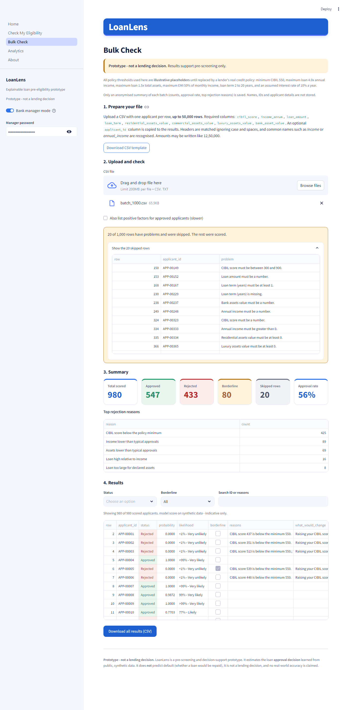
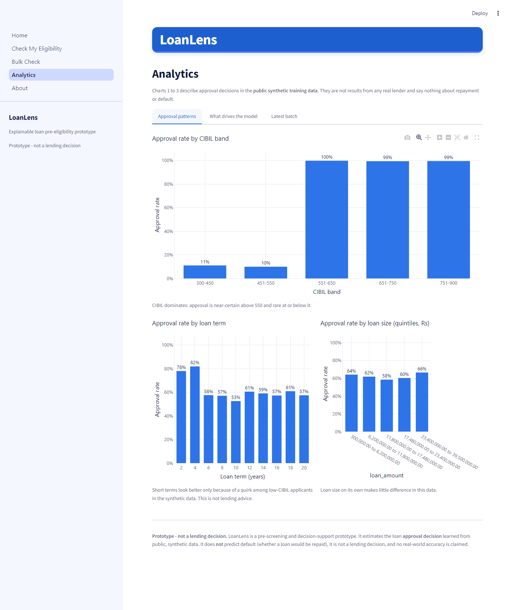
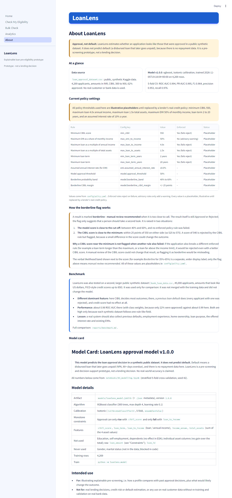

# LoanLens: Explainable Loan Pre-Eligibility & Risk Insights

**LoanLens estimates whether a loan application is likely to be approved or rejected, and explains why in plain language, including what would likely change the result.**

> **Independent proof of concept for learning and demonstration. Not a lending decision. Uses public synthetic data.**



LoanLens is a **pre-screening and decision-support prototype**, an independent proof of concept. It has two modes: a customer checks their own details in a form, and a bank manager uploads a CSV of many applicants and gets a decision, a likelihood and reasons for every row.

> **Approval, not default.** LoanLens predicts the loan *approval decision* recorded in a public, **synthetic** dataset. It does **not** predict default (a disbursed loan that later goes unpaid, NPA / 90+ days overdue), because there is no repayment data. It is not a lending decision, no real customer or bank data is used, and no real-world accuracy is claimed. Every policy threshold is a placeholder, illustrative until replaced by a lender's real credit policy.

Author: Anshu Raj (GitHub: Anshu-raj-co)

## Contents

- [Results at a glance](#results-at-a-glance)
- [Screenshots](#screenshots)
- [Documentation](#documentation)
- [Quick start (fresh clone)](#quick-start-fresh-clone)
- [Data](#data)
- [The pages](#the-pages)
- [How a decision is made](#how-a-decision-is-made)
- [Bank manager password (prototype gate)](#bank-manager-password-prototype-gate)
- [Security notes](#security-notes)
- [Project structure](#project-structure)
- [Development](#development)
- [Limitations](#limitations)
- [What a lender would need to provide to take this further](#what-a-lender-would-need-to-provide-to-take-this-further)
- [Future work](#future-work)

## Results at a glance

| | |
|---|---|
| **Chosen model** | XGBoost with monotone constraints (a higher CIBIL never lowers, a bigger loan never raises the score) and isotonic calibration, on 5 features. Chosen as the simplest model within about 1% of the best; the constraints cost 0.4 ROC-AUC points. |
| **Cross-validation** (stratified 5-fold, seed 42) | ROC-AUC 0.9942, PR-AUC 0.9946, precision 0.9527, recall 0.9759, F1 0.9639, accuracy 0.9546 |
| **Leakage check** | Shuffled labels give ROC-AUC 0.499 (chance). CIBIL alone reaches 0.960; without CIBIL the model drops to 0.584. |
| **Tests** | 281 passing (`pytest`), 98% coverage of `src/loanlens`, `ruff` clean |
| **Batch speed** (measured) | 1,000 rows in about 0.7 s, 10,000 rows in about 6.2 s, 50,000 rows in about 16-32 s |
| **Benchmark** | In the primary dataset, **CIBIL dominates** (about 99% approved above 550, about 10% at or below). In `bank_loan_data.csv`, **a previous default dominates** and credit score alone had almost no effect (ROC-AUC 0.50). |

The scores are near-perfect because the synthetic label is close to a simple rule, not because the problem is easy in reality. Details: [reports/model_card.md](reports/model_card.md) and [reports/benchmark.md](reports/benchmark.md).

## Screenshots

All screenshots use the built-in hypothetical example applicants or the fully synthetic test file.

| | |
|---|---|
|  **Home:** purpose, the illustrative-thresholds notice and links to every page. |  **Check My Eligibility:** the 8-field form with hints and Indian-grouped amounts. |
|  **Approved:** green banner, likelihood band and the factors working in the applicant's favour. |  **Rejected:** red banner, the exact rule that failed, and what would likely change the result. |
|  **Rejected + borderline:** CIBIL 540 is just below the minimum, so manual review is recommended. |  **Bulk Check:** 1,000-row synthetic upload with summary cards, the skipped-rows report and coloured status cells. |
|  **Analytics:** approval patterns in the training data, model drivers and the latest batch. |  **About:** framing, metrics, current policy settings, borderline rules, benchmark and model card. |

## Documentation

- [PROJECT_EXPLAINED.md](PROJECT_EXPLAINED.md): the project in plain English, then a technical deep dive.
- [USER_GUIDE.md](USER_GUIDE.md): step-by-step instructions for customers and bank managers, including the CSV columns.
- [reports/model_card.md](reports/model_card.md): data, metrics, calibration, leakage checks, constraints and limitations.
- [reports/benchmark.md](reports/benchmark.md): comparison with the larger `bank_loan_data.csv` dataset.
- [reports/decisions_log.md](reports/decisions_log.md): every assumption and placeholder, and the reasoning behind each decision.

## Quick start (fresh clone)

Requires **Python 3.11**. Windows commands are shown; on macOS/Linux use `python3.11 -m venv .venv` and `source .venv/bin/activate`.

**1. Get the code and put the data in place.** Download the three CSV files listed under [Data](#data) and save them in `data/raw/` with exactly these names:

```
data/raw/loan_approval_dataset.csv   # primary: powers the app (required)
data/raw/bank_loan_data.csv          # benchmark notebook only
data/raw/loan_data.csv               # sanity check only
```

**2. Install, build the model once, and run:**

```bash
py -3.11 -m venv .venv               # create the virtual environment
.venv\Scripts\activate               # activate it
pip install -r requirements.txt      # pinned packages + LoanLens itself
python -m loanlens.model             # build the cleaned data and the model (models/ is not committed)
streamlit run app/Home.py            # start the app at http://localhost:8501
```

`python -m loanlens.model` cleans `data/raw/loan_approval_dataset.csv` into `data/processed/`, cross-validates the final model and saves `models/loanlens_model.joblib` (well under a minute). If you start the app without it, every page shows a friendly message telling you to run this command; nothing crashes.

This whole sequence was verified from a fresh `git clone` (see `reports/progress.md`).

## Data

The CSV files are third-party Kaggle datasets. They are **not committed** to this repository (`data/raw/` and `data/processed/` are gitignored), so the licence terms of each source apply. Download them from:

| File in `data/raw/` | Source | Role |
|---|---|---|
| `loan_approval_dataset.csv` | Kaggle, "Loan-Approval-Prediction-Dataset" (owner `architsharma01`): https://www.kaggle.com/datasets/architsharma01/loan-approval-prediction-dataset (licence shown: MIT) | **Primary.** 4,269 rows, INR, CIBIL 300-900. Powers the app. |
| `bank_loan_data.csv` | Kaggle, "bank_loan_data" (owner `udaymalviya`): https://www.kaggle.com/datasets/udaymalviya/bank-loan-data (licence shown: MIT) | **Benchmark only** (`notebooks/04_benchmark_bank_loan_data.ipynb`). Never merged with the primary data. Note: this page describes `loan_status` as 1 = repaid, 0 = defaulted, which is why `reports/benchmark.md` treats its label with caution. |
| `loan_data.csv` | A 381-row copy of the widely shared "Loan Prediction" practice dataset (columns `Loan_ID ... Loan_Status`). **Source not verified.** | Sanity check only, otherwise unused. |

Licences were read from Kaggle's dataset metadata; please check each page yourself before redistributing the files. The 1,000-row test file `tests/fixtures/batch_1000.csv` is **fully synthetic** (generated by `scripts/make_batch_fixture.py`); it contains no rows from any dataset.

## The pages

| Page | What it does |
|---|---|
| **Home** | Purpose, the placeholder-thresholds notice, links to every page and a short "how a result is decided" summary. |
| **Check My Eligibility** (customers) | An 8-field form with ranges, hints and Indian-grouped amounts (e.g. "= Rs 1,50,00,000"). Returns a green "Approved" or red "Rejected" banner with the likelihood (e.g. "96% - Very likely", labelled "model score on synthetic data - indicative only"), an amber "Borderline - manual review recommended" pill when relevant, reason cards, "what would likely change this", positive factors, warnings and the policy checks (each marked "Passed" or "Failed"). **Nothing entered is stored or logged.** |
| **Bulk Check** (bank staff) | Behind the manager gate. Download the CSV template, upload up to **50,000 rows**, see invalid rows listed and skipped (with spreadsheet row numbers), a progress bar, summary cards (total, approved, rejected, borderline, skipped, approval rate), top rejection reasons, a results table with status / borderline / search filters, and a CSV download. Only an **anonymised summary** of each batch is saved (`data/loanlens.sqlite`). |
| **Analytics** | Approval rate by CIBIL band, loan term and loan size in the training data; what drives the model (mean absolute SHAP share); and the latest batch summary. |
| **About** | The framing, data source, model metrics, every current policy value with its enforce setting, how the borderline flag works, the benchmark summary and the full model card. |

## How a decision is made

Single source of truth: `src/loanlens/decision.py`. Customer mode and Bulk Check use the same vectorised core, so they always agree. For every application, in order:

1. **Validate** the input (Pydantic). Missing or impossible values return a clear message and no decision.
2. **Policy rules** from `config/policy.yaml`. Each rule has a `value` and an `enforce` flag:
   - *Enforced* rules (minimum CIBIL 550, loan at most 4.0x annual income, loan at most 1.5x total assets, term 2 to 20 years): a failure means **Rejected**, whatever the model says, with that rule as the reason.
   - *Advisory* rules (EMI at most 50% of monthly income, using an **assumed 10% interest rate** because the data has no rate): a failure only adds a warning.
3. **Model**: a calibrated XGBoost probability `p` (features: CIBIL, loan term, loan-to-income, income, total assets; monotone so a higher CIBIL never lowers, and a bigger loan never raises, the score). `p >= 0.5` means Approved.
4. **Borderline flag** ("manual review recommended"): when `p` is between 40% and 60% with no enforced rule failed, or when the CIBIL score is within 25 points of the minimum and no *other* enforced rule failed. The status stays Approved or Rejected.
5. **Reasons**: rule failures first, then the strongest negative model drivers (SHAP) in plain English with "your value" vs a benchmark; at most 5. Every rejection has at least one reason. Approvals get positive factors.
6. **What would change**: the smallest CIBIL increase or loan reduction that would likely flip a rejection ("would likely", never "guaranteed"). It never suggests a shorter term or a bigger loan.

The displayed score never reads 0% or 100% (">99%" / "<1%") and carries a verbal band (Very likely, Likely, Borderline, Unlikely, Very unlikely).

## Bank manager password (prototype gate)

Bulk Check sits behind a sidebar **Bank manager mode** switch plus a password. **This is a prototype gate, not real authentication**: there are no user accounts, roles, lockouts or audit trail.

The password is read, in order, from:

1. the environment variable `LOANLENS_MANAGER_PASSWORD`, or
2. the Streamlit secret `manager_password` in `.streamlit/secrets.toml` (gitignored; never commit it):

   ```toml
   manager_password = "choose-a-password"
   ```

3. otherwise the **local demo default `loanlens-demo`**, and the sidebar says that the demo password is in use.

## Security notes

- The manager gate is a **prototype gate, not real authentication**.
- The documented demo password `loanlens-demo` is for **local use only**. Set your own with `LOANLENS_MANAGER_PASSWORD` or `.streamlit/secrets.toml` before showing the app to anyone.
- **Never host the app publicly with the demo password.**
- Customer mode stores nothing. Bulk Check saves only anonymised batch summaries (counts, approval rate, top reasons) in a local SQLite file; applicant IDs are stored only if `storage.store_applicant_ids` is switched on in `config/policy.yaml` (it is off).
- Datasets, the model file, the SQLite database, `.env` and `.streamlit/secrets.toml` are gitignored. No other password or secret exists in the code or the repository.

## Project structure

```
CLAUDE.md                 project brief and working agreement
README.md, USER_GUIDE.md, PROJECT_EXPLAINED.md
requirements.txt          pinned packages (+ `-e .` for the loanlens package)
requirements-dev.txt      optional extras (Playwright, for screenshots)
pyproject.toml            package, ruff and pytest settings
config/policy.yaml        every threshold, enforce flag and display setting (all PLACEHOLDERS)
.streamlit/config.toml    light theme; stack traces hidden from users
data/raw/                 the three Kaggle CSVs (not committed)
data/processed/           cleaned primary dataset (built by `python -m loanlens.model`)
models/                   saved model artifact (built, not committed)
notebooks/                01_audit, 02_eda, 03_modelling, 04_benchmark_bank_loan_data
src/loanlens/
  schema.py               Pydantic input/output models, friendly validation messages
  cleaning.py             cleaning of the primary dataset
  features.py             EMI, ratios, total assets, CIBIL bands
  rules.py                policy rules (enforced vs advisory)
  model.py                train, cross-validate, calibrate, save, load
  explain.py              SHAP reasons, positive factors, what-would-change search
  decision.py             orchestrates everything (single source of truth)
  batch.py                CSV in, validation, scoring, results out
  storage.py              SQLite, anonymised batch summaries only
  presentation.py         display text and views used by the pages
  formatting.py           Indian digit grouping, score display
  theme.py                every colour, the app CSS and the Plotly template
  charts.py               Plotly charts (Analytics page and notebooks)
  access.py               the prototype manager gate
  config.py, examples.py  policy loading; six hypothetical example applicants
app/                      Streamlit pages (layout only; all logic is in src/loanlens)
reports/                  model card, benchmark, decisions log, progress, examples, screenshots
scripts/                  example_decisions.py, make_batch_fixture.py
tests/                    pytest suite (unit tests and headless page tests); fixtures/ is synthetic
```

## Development

```bash
python -m loanlens.model               # (re)build cleaned data and the model
python -m loanlens.rules               # write reports/rules_vs_labels.md
python scripts/example_decisions.py    # write reports/example_decisions.md
python scripts/make_batch_fixture.py   # regenerate the synthetic tests/fixtures/batch_1000.csv
ruff check .
pytest                                 # 281 tests
pytest --cov=loanlens                  # coverage of src/loanlens (98%)
```

Tests that need the dataset or model skip themselves if `data/raw/` is empty.

## Limitations

- **Synthetic data.** The patterns reflect how the Kaggle dataset was generated, not any real lender's policy or real borrowers. Scores are near-perfect for that reason, not because the problem is easy in reality.
- **CIBIL dominates.** About 99% of applicants above CIBIL 550 are approved and about 10% at or below; CIBIL has 57% of the model's influence. The second feature, loan term, matters only because of a synthetic quirk (short-term, low-CIBIL approvals), and "what would change" never suggests changing the term.
- **Approval, not default.** Nothing here measures repayment risk.
- **Placeholder thresholds.** Every value in `config/policy.yaml` (minimum CIBIL, loan-to-income, loan-to-assets, term limits, EMI cap, borderline band and margin, likelihood bands, which rules are enforced) is illustrative until replaced by a lender's real credit policy.
- **Assumed interest rate.** The data has no rate or existing EMIs, so EMI uses an assumed 10% a year and the EMI-to-income rule is advisory only.
- **Narrow training ranges.** Loan-to-income only spans 1.5 to 4.0 in the data; inputs outside the training ranges get a warning.
- **Prototype gate.** The manager password is not real authentication.

## What a lender would need to provide to take this further

- **Its real credit-policy thresholds** and which rules are hard rules, replacing every placeholder in `config/policy.yaml` (the full list is at the top of [reports/decisions_log.md](reports/decisions_log.md)).
- **Repayment outcome data** for disbursed loans, to build a separate default-risk model with its own target.
- **Integration with its systems** (loan origination, credit bureau pulls, product interest rates and existing EMIs).
- **Proper authentication and audit logging** for staff, replacing the prototype gate.
- **A compliance and fairness review** of the data, features, reasons and wording before any use with real applicants.

## Future work

- **Real repayment data**, so that default risk could be studied.
- **Real policy thresholds** (and enforce settings) from a lender, replacing every placeholder.
- **Authentication** for bank staff (accounts, roles, audit log) instead of the prototype gate.
- **A default-risk model**, as a separate model with its own target, once repayment outcomes exist.
- **Power BI dashboard** fed by exported, dashboard-ready CSVs.
- Collecting the fields the benchmark shows are missing: previous defaults, employment experience, home ownership, loan purpose, offered interest rate and existing EMIs (`reports/benchmark.md`).
